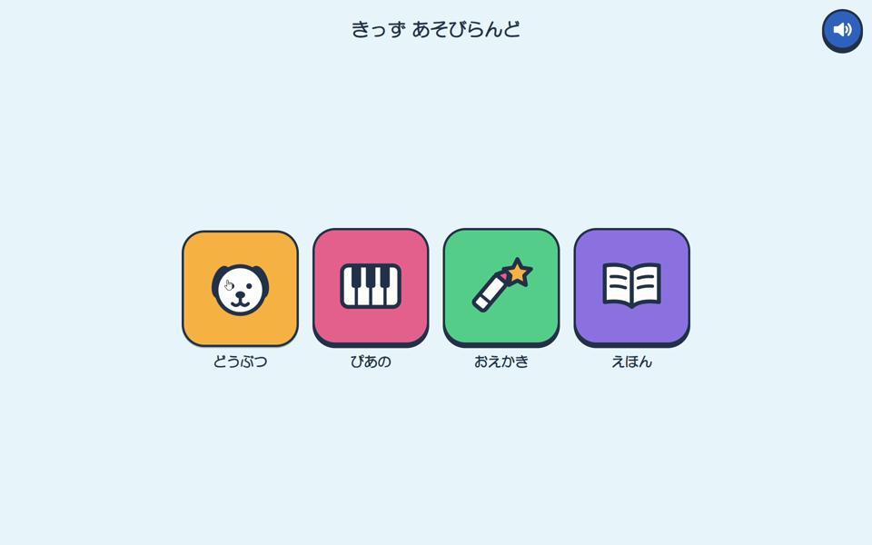
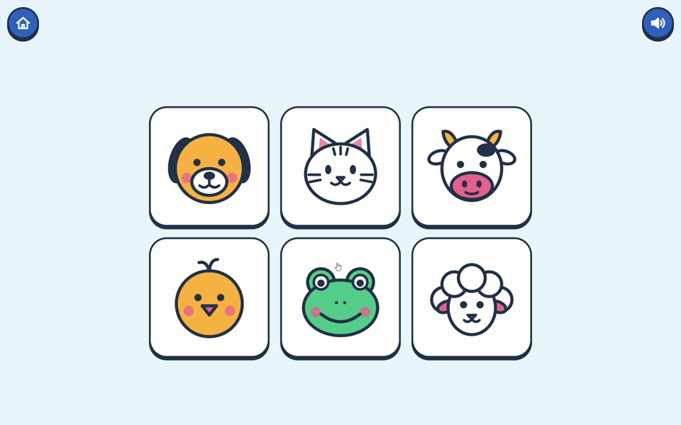
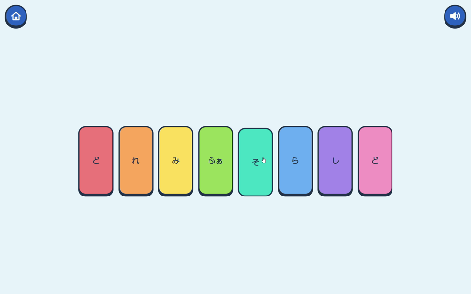
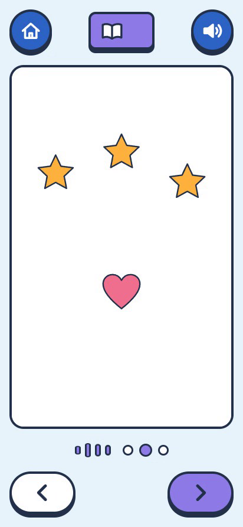
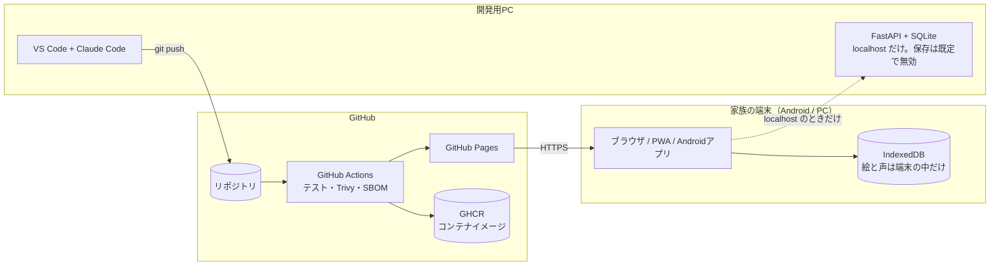

# キッズあそびランド（kids-play）

4〜8歳の子ども向けミニアプリ集。Web、PWA、Androidアプリで遊べる。
21日間の個人学習プロジェクトとして、Web開発からCI/CD、クラウド、セキュリティまでを一通り体験し、続けて最新の技術とセキュリティを試した。

> 状態：完了（2026-10-08〜11-06 の21日間）。14日間の学習を 2026-10-28 に、発展の学習（スプリント3、7日間）を 2026-11-06 に完了した。新しい機能の開発はせず、今は依存関係とイメージの更新だけを行っている

## ミニアプリ

| | なまえ | 内容 |
|---|---|---|
| 1 | どうぶつタッチ | 動物をタップすると鳴き声とアニメーション |
| 2 | おとあそびピアノ | 色の鍵盤をタップすると音が鳴る |
| 3 | おえかきスタンプ | 指でお絵かき、スタンプ、画像として保存 |
| 4 | わたしのえほん | 描いた絵に声を録音し、紙芝居のように再生 |

## スクリーンショット

| トップ | どうぶつタッチ | おとあそびピアノ | わたしのえほん |
|---|---|---|---|
|  |  |  |  |

文字に頼らず、大きな絵とアイコンで遊べるようにした。映っている絵はすべてサンプル（自作SVG）。

## 紹介動画

1分で、ミニアプリ、Androidアプリ、えほん（サンプルデータ）、マージから AWS への自動デプロイまでを紹介する。

https://github.com/user-attachments/assets/e48b3895-02bf-483d-bb89-e8952b75ec23

- 映っている絵と音は、すべてサンプル（自作SVGと合成音）。人の声は入っていない
- 編集：DaVinci Resolve（無料版）。タイトルと最後の場面は Remotion でコードから作成（[video/title/](video/title/)）。作り方は [docs/video-storyboard.md](docs/video-storyboard.md)

## 発表資料

| 資料 | 内容 |
|---|---|
| [成果発表（PowerPoint、18枚）](docs/slides/kids-play-presentation.pptx) | 目的と結果、作ったもの、構成図、21日間の進め方、プライバシーとセキュリティ、AI との分担、学んだこと、失敗から学んだこと、スプリント3の成果、次の一歩 |
| [1枚資料（PowerPoint）](docs/slides/kids-play-one-pager.pptx) | 全体を1枚にまとめたもの |
| [AUTOSAR 体系的入門（PowerPoint）](docs/slides/AUTOSAR%20体系的入門.pptx) | 18日目の AUTOSAR の入門（[docs/autosar-intro.md](docs/autosar-intro.md)）をスライドにしたもの |

成果発表と1枚資料は Claude Design（Claude Code の会話の中）で、アプリのデザインシステムを読み込んで作った。数字は21日目（2026-11-06）の時点のもの。成果発表の6枚目には、1分の紹介動画が入っている（クリックで再生）。

## 遊び方

| 環境 | 方法 |
|---|---|
| Web（GitHub Pages） | https://hayato-f110.github.io/kids-play/ |
| PWA | 上のURLをAndroidのChromeで開き、「ホーム画面に追加」 |
| Androidアプリ | Android Studioでビルドし、USBデバッグで実機にインストール（Google Playでは配布しない） |
| AWS版（HTTPS） | 2026-10-24〜10-28 に公開し、学習の区切りで終了した（AWS のリソースは削除済み）。作り方は [docs/architecture.md](docs/architecture.md) と `server/` に残している |
| ローカル（PC） | 下の「PC で動かす」 |

### PC で動かす

```powershell
# フロントエンドだけ（サーバーなしで動く）。http://localhost:8000 を開く
python -m http.server 8000 --directory frontend

# nginx + FastAPI のコンテナ（Docker Desktop が必要）。http://127.0.0.1:8080 を開く
docker compose up -d --build
```

サーバーへの保存は、既定で無効。PC の中（localhost）で動かす場合だけ、環境変数で有効にできる（[docs/storage-interface.md](docs/storage-interface.md)）。

## 使用技術

| 分野 | 技術 |
|---|---|
| フロントエンド | HTML / CSS / JavaScript（フレームワークなし、ES Modules）、Web Audio API、Canvas、Pointer Events、IndexedDB、MediaRecorder |
| PWA / Android | Web App Manifest、Service Worker、Capacitor |
| バックエンド | Python、FastAPI、SQLite、uv、pytest、ruff |
| コンテナ | Docker、docker compose |
| CI/CD | GitHub Actions、GitHub Container Registry、GitHub Pages |
| クラウド・サーバー（12〜14日目） | AWS（EC2、IAM、OIDC、Systems Manager）、Ubuntu、nginx、DuckDNS、Let's Encrypt |
| セキュリティ | 脅威分析（STRIDE）、Secret scanning、Dependabot、CodeQL、Trivy、SBOM（CycloneDX）、pip-audit、OWASP ZAP、SSL Labs |
| 動画 | DaVinci Resolve、Remotion |
| 進め方 | Jira（スクラム）、Claude Code、Claude Design |
| AI（15日目） | MCP（Python SDK）、Gemini API、RAG、evals |
| サプライチェーン（16日目） | Sigstore（cosign のキーレス署名）、GitHub artifact attestations、SLSA、C2PA |
| 検証（17日目） | libFuzzer、ASan / UBSan、cppcheck、CodeQL（C）、Rust |
| ゼロトラスト（18日目） | パスキー（WebAuthn）、短い期限のトークン、mTLS、TypeScript、SecOC の模擬、AUTOSAR の入門 |
| 暗号・データ（19日目） | ML-KEM のハイブリッド鍵交換（X25519MLKEM768）、CBOM、DuckDB、PHP、Composer |
| 運用（20〜21日目） | Kubernetes（kind）、NetworkPolicy、Pod Security、OpenTelemetry、Jaeger、OpenTofu |

## 構成図



AWS 版（EC2、nginx、HTTPS、OIDC と SSM による自動デプロイ）は 2026-10-24〜10-28 に動かし、14日目に片付けた。そのときの構成と片付けの記録は [docs/architecture.md](docs/architecture.md)。

## CI/CDの流れ

1. プルリクエスト：フロントとバックエンドのテスト、TypeScript の型の検査、スプリント3の道具（`tools/`）のテスト、OpenTofu の検査、コンテナイメージの検査（Trivy。直し方のある CRITICAL があれば失敗）、SBOM の作成、CodeQL
2. main へのマージ：検査を通ったイメージを GHCR へ push し、cosign で署名して来歴（attestation）を付ける。`frontend/` は GitHub Pages へ公開
3. （13〜14日目）OIDC で AWS のロールを引き受け、SSM Run Command で EC2 へデプロイしていた。AWS の片付けに合わせて外した

詳細は [docs/architecture.md](docs/architecture.md)。

## プライバシー方針

- 子どもが描いた絵と録音した声は、**端末の中にだけ**保存する。公開サーバーには送信しない
  - おえかきスタンプの「ほぞん」：絵をPNGにして、端末のダウンロードフォルダに保存する
  - わたしのえほん：絵と声を、ブラウザの中の保存場所（IndexedDB）に保存する
- 保護者の方へ：「ほぞん」した絵は、ふつうの画像ファイルとして端末に残る。写真アプリのクラウド同期や端末のバックアップが有効だと、端末の外にも保存される。必要に応じて、同期の設定を確認し、要らない絵は削除する
- 広告、解析、外部への通信はない
- このリポジトリと公開サイトに含まれる絵と音は、すべてサンプル（自作SVGと合成音）である
- サーバーへの保存機能は、開発者のPC内（localhost）で動かす場合にのみ有効になる

## セキュリティ

- 脆弱性の報告：[SECURITY.md](SECURITY.md)（GitHub の非公開の報告の仕組みを使う）
- 脅威分析：[docs/security/threat-model.md](docs/security/threat-model.md)（データフロー図、STRIDE、ISO/SAE 21434 との対応）。脅威 35件、対策 38件（スプリント3で、AI エージェント、署名、ゼロトラスト、Kubernetes などを追加）
- 報告書：[docs/security/security-report.md](docs/security/security-report.md)（14日目の時点のまとめ。脅威 23件、対策 26件）
- 秘密情報はリポジトリに含めない。GitHub Actions から AWS へは OIDC で接続し、アクセスキーを発行しなかった

## Claude Codeの活用方法

このプロジェクトは Claude Code と一緒に進めた。コードは Claude が書き、学習者は依頼・動作確認・判断を担当した。

- 設定の説明：[docs/claude-code-guide.md](docs/claude-code-guide.md)
- 活用ガイド（QCD別）：[docs/claude-code-playbook.md](docs/claude-code-playbook.md)
- 仕事に持ち帰るスキル・エージェント・Hook をまとめたプラグイン：[plugins/claude-dev-kit/](plugins/claude-dev-kit/)
- 紹介動画のタイトルと最後の場面は、Claude Code に Remotion のコードを書かせて作った：[video/title/](video/title/)
- 学習ログ：[docs/learning-log.md](docs/learning-log.md)

## ドキュメント

| ファイル | 内容 |
|---|---|
| [docs/plan.md](docs/plan.md) | 計画（14日間とスプリント3） |
| [docs/design.md](docs/design.md) | デザインのルールと方針 |
| [docs/architecture.md](docs/architecture.md) | 構成図、CI/CDの流れ、AWS のリソースと片付けの記録 |
| [docs/storage-interface.md](docs/storage-interface.md) | えほんの保存のインターフェース |
| [docs/security/security-report.md](docs/security/security-report.md) | セキュリティ報告書 |
| [docs/security/threat-model.md](docs/security/threat-model.md) | 脅威分析 |
| [docs/security/](docs/security/) | スプリント3の各日のセキュリティの記録（下の表を参照） |
| [docs/autosar-intro.md](docs/autosar-intro.md) | AUTOSAR の入門（層、SecOC の呼び出しの流れ、模擬との対応） |
| [docs/k8s-otel.md](docs/k8s-otel.md) | kind で動かす手順と、OpenTelemetry |
| [docs/video-storyboard.md](docs/video-storyboard.md) | 紹介動画の絵コンテと編集の記録 |
| [docs/learning-log.md](docs/learning-log.md) | 毎日の学習ログ |
| [docs/glossary.md](docs/glossary.md) | 用語集 |

## 素材の出典

| 素材 | 作者・出典 | ライセンス |
|---|---|---|
| 画像（SVG） | 自作 | – |
| 音 | Web Audio APIで生成 | – |
| 紹介動画 | 自作（画面の録画、Remotion で作ったタイトル） | – |

外部の素材を使う場合は、ライセンスと再配布可否を確認してここに記載する。

## スプリント3でやったこと

2026-10-29〜11-06 の7日間。いま広く求められている技術とセキュリティを、kids-play と自作の小さなサンプルを題材に一通り試した。どれも手元（localhost、Docker、kind）で動かし、AWS は使っていない。詳細は [docs/plan.md](docs/plan.md) と [docs/learning-log.md](docs/learning-log.md)。

| 日 | テーマ | 記録とコード |
|---|---|---|
| 15日目 | MCP サーバーの自作、RAG と evals、プロンプトインジェクションの試験 | [docs/security/ai-injection.md](docs/security/ai-injection.md)、[tools/ai/](tools/ai/) |
| 16日目 | コンテナイメージの署名と来歴、生成 AI と C2PA | [docs/security/provenance.md](docs/security/provenance.md) |
| 17日目 | Web とサーバーの基礎、C のファジングと静的解析、Rust での書き直し | [docs/security/fuzzing.md](docs/security/fuzzing.md)、[practice/tlv/](practice/tlv/) |
| 18日目 | ゼロトラスト（パスキー、mTLS）、TypeScript、SecOC の模擬、AUTOSAR の入門 | [zerotrust/](zerotrust/)、[tools/secoc/](tools/secoc/)、[docs/autosar-intro.md](docs/autosar-intro.md) |
| 19日目 | 耐量子暗号の TLS と計測、CBOM、PHP の掲示板（SQLi・XSS・CSRF）、CAN の模擬ログの異常検知 | [docs/security/pqc-tls.md](docs/security/pqc-tls.md)、[docs/security/cbom.md](docs/security/cbom.md)、[docs/security/php-bbs.md](docs/security/php-bbs.md)、[docs/security/can-ids.md](docs/security/can-ids.md) |
| 20日目 | Kubernetes（kind）で動かして守る、OpenTelemetry | [k8s/](k8s/)、[docs/k8s-otel.md](docs/k8s-otel.md) |
| 21日目 | OpenTofu、規制と標準の動向、Uptane、振り返り | [infra/tofu/](infra/tofu/)、[docs/security/regulatory-trends.md](docs/security/regulatory-trends.md)、[docs/security/uptane.md](docs/security/uptane.md) |

PHP の掲示板（[tools/bbs/](tools/bbs/)）は、わざと危険な書き方を含む学習用のコード。localhost だけで動かし、動かす前にイメージの版を上げる（[docs/security/php-bbs.md](docs/security/php-bbs.md)）。

## その先

学習は別のプロジェクトに移った。このリポジトリに残した発展の候補（手が空いたときに行う）：OpenTofu による AWS の構成のコード化、CloudWatch による監視、TypeScript への移行、Kotlin でのネイティブ機能。
