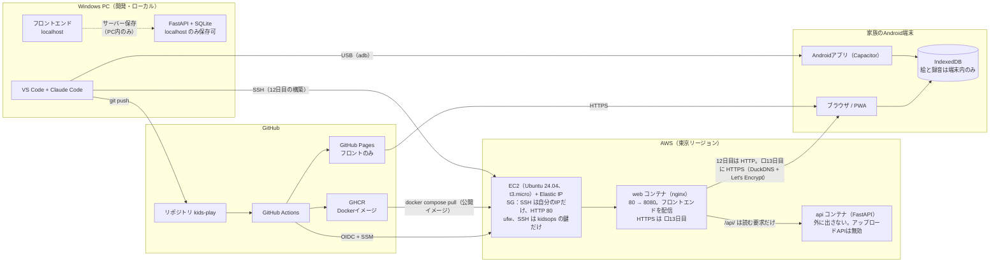
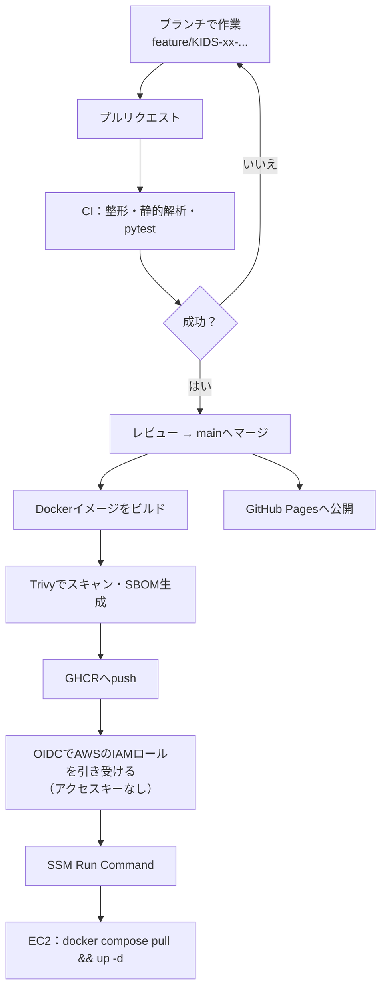

# 構成

雛形。各日の作業で実態に合わせて更新する（⬜＝未構築）。

## 動かす場所の全体像

## データの置き場所（プライバシーの要点）

| 環境 | 絵と録音の保存先 | サーバーへの送信 |
|---|---|---|
| PC（localhost） | IndexedDB、または設定でFastAPI + SQLite | PC内のみ |
| GitHub Pages | IndexedDB（端末内） | なし |
| Androidアプリ / PWA | IndexedDB（端末内） | なし |
| AWS版 | IndexedDB（端末内） | なし（アップロードAPIは無効） |

保存先の切り替えは環境変数で行い、既定は「サーバー保存なし」とする（設定を忘れても安全側に倒れる）。

## CI/CDの流れ

## 構築の状況

| 要素 | 状態 | 構築日 | メモ |
|---|---|---|---|
| ローカルのフロントエンド | ✅ | 2日目 | トップ画面とどうぶつタッチ。`python -m http.server` で確認 |
| GitHub Pages | ✅ | 5日目 | |
| PWA | ✅ | 5日目 | |
| Androidアプリ | ✅ | 6日目 | |
| FastAPI（localhost） | ✅ | 10日目 | 127.0.0.1:8000。サーバー保存は既定で無効 |
| Docker / compose | ✅ | 11日目 | WSL2（Ubuntu 24.04）＋ Docker Desktop。`docker compose up -d --build` で 127.0.0.1:8080。web（nginx）と api（FastAPI）、どちらも root 以外。サーバー保存は無効 |
| CI（GitHub Actions、GHCR） | ✅ | 11日目 | `.github/workflows/ci.yml`。PR でテストとイメージの検査（Trivy で CRITICAL なら失敗、SBOM を成果物に）。main で GHCR へ push（公開。`ghcr.io/hayato-f110/kids-play-api`・`kids-play-web`、タグは `main` と `sha-<コミット>`） |
| EC2 + nginx（HTTP） | ✅ | 12日目 | Ubuntu 24.04、t3.micro（クレジット仕様は標準）。`server/compose.yaml` で GHCR のイメージを起動（web だけ 80 で外に出す）。ログは journald（14日・200MB、ファイルは1日ごとに切り替え。`server/journald/`）。`/opt/kids-play` には `compose.yaml` だけを置く。ハードニングは docs/security/threat-model.md の C-15 |
| HTTPS（DuckDNS + Let's Encrypt） | ⬜ | 13日目 | |
| CD（OIDC + SSM） | ⬜ | 13日目 | |

## AWSのリソース一覧（12日目から記入。14日目の後片付けの確認に使う）

IDやIPアドレスなど、公開したくない値は書かない（種類と個数だけ書く）。

アカウントは無料プラン（2026-10-23 作成。$100 のクレジット、6か月で自動で閉じる。請求は起こらない）。料金はクレジットから引かれる。

| リソース | 個数 | 料金が発生する条件 | 削除済み |
|---|---|---|---|
| EC2 インスタンス（t3.micro、東京） | 1 | 動いている間（$0.0136／時間）。止めれば止まる | ⬜ |
| EBS ボリューム（gp3 10GiB、暗号化） | 1 | あるだけでかかる（インスタンスを止めてもかかる）。インスタンスを終了すると一緒に消える設定 | ⬜ |
| Elastic IP | 1 | あるだけでかかる（$0.005／時間。つないでいなくても同じ）。インスタンスを消しても残るので、別に解放する | ⬜ |
| セキュリティグループ（kids-play-sg） | 1 | かからない | ⬜ |
| キーペア（kids-play-ec2、ED25519） | 1 | かからない。秘密鍵は PC の `~/.ssh` にだけある | ⬜ |
| AWS Budgets（ゼロ支出、月 $15） | 2 | かからない（通知だけの予算） | ⬜ |
| IAM ユーザー（kids-admin、MFA あり、アクセスキーなし）とグループ（admins） | 1・1 | かからない | ⬜ |
