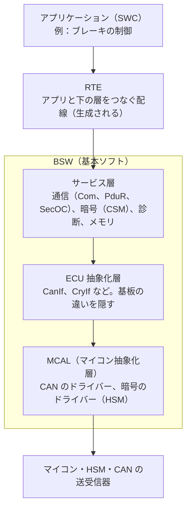
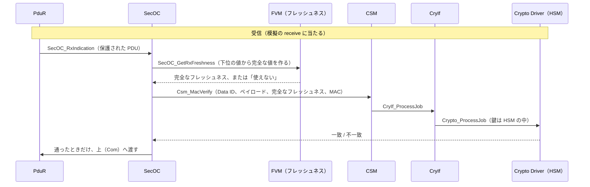

# AUTOSAR の入門と、SecOC の模擬（18日目、KIDS-62）

AUTOSAR の層の形と、SecOC から暗号のドライバーまでの呼び出しの流れを、自分の言葉でまとめる。
模擬（[tools/secoc/](../tools/secoc/)）は、この流れと同じ層の形にした。**AUTOSAR の実装ではない。**

- 確かめた資料：AUTOSAR R25-11 の Classic Platform の仕様書（SecOC：文書番号 654、CryIf）。2026-11-03 に autosar.org から取得
- 利用条件：仕様書の Disclaimer は「情報を得る目的に限り、変えずに使い、写してよい。それ以外の目的は書面の許可が要る。中身を商業で使うには、知的財産権のライセンスが要る」。この文書は学習のための要約で、仕様の文章と図は写していない。関数の名前だけを使う
- 仕様書で確かめたのは、関数の名前と呼び出しの向きまで。Classic と Adaptive の違い、層の役割は、広く知られている説明に基づく要約で、仕様書の章ごとには照らしていない

## 1. Classic Platform と Adaptive Platform

| | Classic Platform | Adaptive Platform |
|---|---|---|
| 向いている ECU | 制御の ECU（エンジン、ブレーキ、ボディ）。マイコン | 高性能の ECU（自動運転、ゲートウェイ、インフォテインメント）。マイクロプロセッサー |
| 言語 | C | C++ |
| 構成 | ビルドの前に全部を決める（静的な設定） | 動いている間にアプリを足し替えできる |
| 通信 | 信号と PDU（CAN、LIN、FlexRay、Ethernet） | サービス指向（SOME/IP など） |
| OS | AUTOSAR OS（OSEK を元にした小さな OS） | POSIX の OS |
| 今日の SecOC | **ここで使う**（PDU に MAC とフレッシュネスを付ける） | 今日は扱わない |

kids-play で例えると、Classic は「ビルドの時点で全部決まった、フロントのミニアプリ」、Adaptive は「あとから機能を足せる、サーバー（FastAPI とコンテナ）」に近い。

## 2. Classic Platform の層

| 層 | 役割 | C での例え |
|---|---|---|
| SWC | 機能そのもの。ハードを知らない | アプリの関数 |
| RTE | SWC と BSW の間の呼び出しを、設定から生成する | 自動生成のグルーコード |
| サービス層 | 通信・暗号・診断などの共通の仕事 | ミドルウェアのライブラリ |
| ECU 抽象化層 | 基板ごとの違いを隠し、上に同じ口を見せる | HAL |
| MCAL | マイコンのレジスターを触る | ペリフェラルのドライバー |

## 3. SecOC の呼び出しの流れ

SecOC はサービス層にあり、送る PDU に MAC とフレッシュネスを付け、受けた PDU を確かめる。暗号は自分で計算せず、CSM に頼む。

送信は逆向きで、`SecOC_GetTxFreshness` で値をもらい、`Csm_MacGenerate` で MAC を作って、`PduR_SecOCTransmit` で下へ流す。

## 4. 模擬との対応

| AUTOSAR | 模擬（`tools/secoc/secoc_sim/`） | 違い |
|---|---|---|
| SecOC | `SecOC`（`send`、`receive`） | 本物は PduR から呼ばれ、PduR へ返す。模擬はバイト列を直接受け取る |
| FVM（`SecOC_GetRxFreshness` など） | `FreshnessValueManager` | 本物は SecOC の外の部品（ベンダーやプロジェクトが作る）。時刻を使う方式、マスターと同期する方式もある。模擬はカウンターだけ |
| CSM（`Csm_MacVerify`） | `CSM`（ジョブ番号で呼ぶ） | 本物は非同期のジョブにもでき、終わるとコールバックで知らせる |
| CryIf（`CryIf_ProcessJob`） | `CryIf`（チャネルからドライバーを選ぶ） | ほぼ同じ考え方 |
| Crypto Driver（`Crypto_ProcessJob`） | `CryptoDriver`（AES-128 CMAC。鍵スロット） | 本物は HSM の中で計算し、鍵は HSM の外に出ない。模擬はメモリの辞書で、外へ返す関数を作らないことで形だけ真似た |
| 鍵の管理（KeyM など） | なし（テストの固定値） | 本物は鍵の配布・更新・失効を別の仕組みで行う |

模擬のログ（`uv run python -m secoc_sim.demo`）で、`[SecOC] -> CSM` → `[CSM] -> CryIf` → `[CryIf] -> CryptoDriver` の順に追える。

## 5. 今日のゼロトラストとの対比

| | SecOC（車内） | 今日の kids-play（PC の中のコンテナ） |
|---|---|---|
| 誰が送ったか | 共通鍵の MAC（同じ鍵を持つ ECU だけが作れる） | mTLS の証明書（nginx だけが持つ）とトークン（パスキーでログインした人だけ） |
| 再送を断る | フレッシュネス（カウンター） | チャレンジは1回だけ、トークンは5分 |
| 内側を信じない | ゲートウェイの内側の ECU も、PDU ごとに確かめる | nginx の内側の api も、要求ごとに確かめる |
| 短くする理由 | CAN の帯域（MAC 24ビット、フレッシュネス 8ビット） | なし（HTTP なので大きくてよい） |
| 鍵 | HSM の中。長く使う | 起動ごとに作り、メモリにだけ置く |

21434 の TARA では、どちらも「なりすまし（S）」と「改ざん（T）」への対策で、フレッシュネスとチャレンジは「再送」への対策にあたる。
