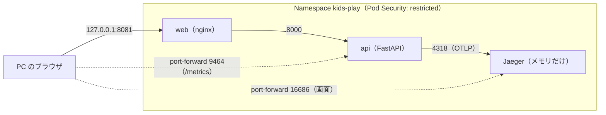

# kind（Kubernetes）と OpenTelemetry（20日目、KIDS-64）

kids-play を、手元の小さな Kubernetes（kind）で動かし、「既定で拒否」の規則で守った。
FastAPI に OpenTelemetry を入れ、要求の流れ（トレース）と時間（メトリクス）を見えるようにした。
脅威分析は [threat-model.md](security/threat-model.md) の T-33、T-34、C-36、C-37。

## 使った版（2026-11-05 に公式で確認）

| もの | 版 | 備考 |
|---|---|---|
| kind | v0.33.0 | Windows の exe（10.8MB）。チェックサムを確かめて `%LOCALAPPDATA%\Programs\kind` に置いた |
| ノード（Kubernetes） | v1.37.0 | `kindest/node` を digest で固定（kind の案内どおり）。ディスク上で 1.34GB |
| kubectl | v1.36.1 | Docker Desktop に同梱のもの。サーバーとの差が1つ以内なので使える |
| NetworkPolicy | kindnet（kind の既定） | kind v0.24.0 から、追加の部品なしで規則が効く |
| Jaeger | v2.22.0 | OTLP を直接受けるので、Collector を立てなかった。ディスク上で 175MB |
| OpenTelemetry（Python） | 1.45.1 / 0.66b1 | 最新の 1.45.2 は公開から7日たっていない（T-04）ので、1つ前 |

## 構成



- NetworkPolicy は、まず入りと出をすべて拒否し、上の実線の3本と DNS だけを許した
- port-forward は、kubelet が Pod の中へ直接つなぐので、NetworkPolicy を通らない。だから、画面とメトリクスは Service に載せず、port-forward でだけ見る

## 動かし方（PowerShell、リポジトリの一番上で）

```powershell
kind create cluster --name kids-play --config k8s/kind-config.yaml  # クラスターを作る（最初の1回）
./scripts/k8s-up.ps1                                                # ビルド → kind に入れる → 順番に適用
./scripts/k8s-verify.ps1                                            # 試験（PASS / FAIL）
kubectl --context kind-kids-play -n kids-play port-forward deploy/jaeger 16686:16686 --address 127.0.0.1  # Jaeger の画面
kind delete cluster --name kids-play                                # 片付け（kubeconfig の項目も消える）
```

`kubectl apply -f k8s/` でまとめて入れてはいけない。名前の順に処理されるため、Namespace より先に api が処理されて失敗する。また、nginx は起動のときに api の名前を引くので、api の Service を先に作る必要がある。そのため、`k8s-up.ps1` で順番を決めた。

## 試験の結果（`scripts/k8s-verify.ps1`）

| 試験 | 結果 |
|---|---|
| a. 127.0.0.1:8081 でトップ画面 | PASS（画面なしの Edge でも画像を確かめた） |
| b. 許可：web → api:8000、api → jaeger:4318 | PASS |
| c. 拒否：web → jaeger:4318、web → api:9464、api → jaeger:16686、api → 1.1.1.1:443 | PASS（4つとも時間切れ）。規則を一時的に外すと、web → jaeger と api → 外が通った。止めていたのは規則だと確かめた |
| d. 特権の Pod、root の Pod を断る。規則を満たす Pod は通る（対照） | PASS |
| e. ノードのポートは 127.0.0.1 だけ（API サーバーと入口） | PASS |
| f. Jaeger に `kids-play-api` のトレースがあり、クエリの値がない | PASS。学習者がブラウザで `GET /api/storage/status`（1.5ms、200）を見た |
| g. Trivy の設定検査 | CI の `k8s-config` で行う |

pytest（`backend/tests/test_telemetry.py`、13件）では、既定で無効なこと、ヘッダー・クエリ・本文・User-Agent が残らないことを確かめた。

## 分かったこと

- **計装の部品の既定は「多めに記録」**：FastAPI の計装は、クエリ（`?secret=...`）と User-Agent を、既定でスパンに入れた。テストで目印の文字列を送って見つけ、受けた直後に消す処理を足した。消す処理を外すとテストが失敗することも確かめた
- **Kubernetes の既定は「何でも許す」**：compose は「書かなければ届かない」だったが、Kubernetes は Pod どうしが全部つながる。守りは自分で足す（NetworkPolicy と Pod Security）
- **「止まった」の試験は、止める理由を1つに絞る**：Service の名前でつなぐと、Service に載せていないポートは規則と関係なく失敗する。Pod の IP へ直接つなぎ、時間切れ（規則で捨てた）と拒否（つなぎ先がない）を分けた
- **Jaeger 2.22 では、古い API（`/api/traces`）がなくなっていた**：試験は `/api/v3` で行う。画面は変わらず使える
- **PowerShell の関数に渡した `--` は、PowerShell が取り除く**：`kubectl exec ... -- コマンド` は、関数を通さずに書く

## `claude -p` のレビュー（読むだけの道具に限定）

`claude -p --allowedTools "Read,Glob,Grep"` に、観点（Pod Security、NetworkPolicy、外への露出、起動の失敗、テレメトリーの漏れ）を渡した。終了コードは 0、指摘は「高 0／中 2／低 5」。

| 指摘 | 対応 |
|---|---|
| 中：kids-play のイメージが C-36 (4)（GHCR の digest）と食い違う | 文書を実装に合わせて直し、GHCR の版は発展に回した |
| 中：`kubectl apply -f k8s/` は順番の都合で失敗する | `scripts/k8s-up.ps1` で順番を決めた |
| 低：User-Agent が既定で記録される | テストを足して失敗を確かめてから、消す処理を足した |
| 低：web の入口のコメントが不正確 | 直した |
| 低：例外のメッセージがスパンに残る、Jaeger のメモリの上限で黙って消える、`/health` の除外がない | 受け入れた（保存が無効、試し用、探りは TCP）。脅威分析に記録 |

レビューは、本線とは別の会話で、観点を決めて行わせると、自分で書いたものの見落とし（User-Agent、適用の順番）が出てきた。実際に動かしたときの失敗（`--`、Jaeger の API）は、レビューでは見つからず、試験で見つかった。

## 車載との対比

| ここ | 車載 |
|---|---|
| マニフェスト（あるべき状態を宣言し、Kubernetes が保つ） | AUTOSAR の ECU の構成の記述（ARXML）。違いは、Kubernetes は動いている間ずっと「あるべき状態」に戻そうとすること |
| NetworkPolicy（既定で拒否、許す道だけ書く） | ゲートウェイの通信の許可リスト（どの ECU のどの ID を、どのバスへ通すか） |
| Pod Security（restricted） | ECU の中の権限の分離（MPU、ハイパーバイザーでの区画） |
| トレースとメトリクス | 車両のログと DTC、クラウド側の監視（R155 の監視と対応）。送る中身を絞るのは、車両のデータの最小化と同じ |
| kind のクラスター | OTA サーバーなど、クラウド側の構成の試し場。21434 の範囲には、車両だけでなくバックエンドも入る |
