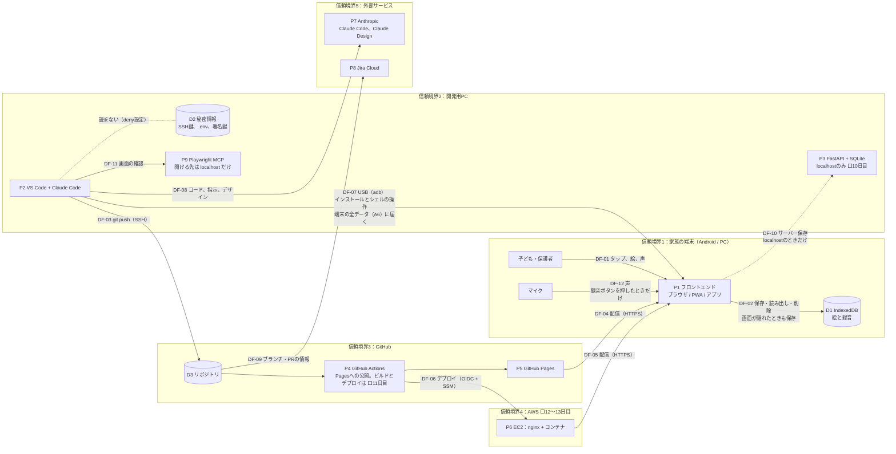

# 脅威分析（Threat Model）

初版（2026-10-09）。7日目（2026-10-14）に見直した（4章の「7日目の見直し」）。構成が変わる日（5日目、10日目、11日目、12日目）にも、該当する脅威を見直す。

- 手法：データフロー図 + STRIDE
- 対象：自分が管理するリポジトリ、アプリ、サーバーのみ

## 1. 保護すべき資産

| # | 資産 | なぜ守るか | 置き場所 | 重要度 |
|---|---|---|---|---|
| A1 | 子どもの絵と声 | 子どものプライバシー。流出すると取り返せない | 端末内（IndexedDB、おえかきの「ほぞん」で作るPNG：ブラウザとPWAはダウンロードフォルダ、Androidアプリ版は `Pictures/AsobiLand`）、localhostのSQLite | 高 |
| A2 | 秘密情報（AWS認証情報、SSH秘密鍵、DuckDNSトークン、署名鍵） | 悪用されるとサーバーの乗っ取りや課金につながる | 自分のPC、GitHub Secrets | 高 |
| A3 | サーバー（EC2）とAWSアカウント | 踏み台や不正利用、高額請求 | AWS | 高 |
| A4 | ソースコードと配布物の完全性 | 改ざんされたアプリが子どもの端末で動く | GitHub、GHCR、GitHub Pages | 中 |
| A5 | 子どもの安全な体験（聴覚、目、不適切な内容に触れないこと） | 大音量、激しい点滅、外部リンクや広告は、子どもに直接の害になる | フロントエンドの実装 | 高 |
| A6 | 開発に使う端末とPCにある、このアプリと関係のない個人のデータ（写真、動画、文書、ほかのアプリの画面） | 失うと取り返せない。開発の道具（adb、シェル）からは、アプリのデータと同じように手が届く | 家族のAndroid端末（内蔵と microSD）、開発用PC | 高 |

## 2. データフロー図

枠（subgraph）が信頼境界。枠をまたぐ矢印（DF-xx）が、脅威を探す主な場所になる。
⬜ はまだ作っていない要素（作る日）。7日目の見直しで実態に合わせる。

設計上の要点：DF-01、DF-02、DF-12 で扱う絵と声（A1）は、信頼境界1の外へ出る矢印を持たない。声の流れは「マイク → 録音（P1 の中の Blob）→ 保存（D1）→ 再生（P1 の Web Audio）」で、どこでも端末の外へ出ない。DF-10 は開発用PCの中だけで有効になる。

## 3. 脅威の洗い出し（STRIDE）

| STRIDE | 意味 | 車載での例 |
|---|---|---|
| **S**poofing | なりすまし | 不正なECUや診断機のなりすまし |
| **T**ampering | 改ざん | CANメッセージやファームウェアの改ざん |
| **R**epudiation | 否認 | 操作の記録が残らない |
| **I**nformation disclosure | 情報漏えい | 鍵や個人情報の読み出し |
| **D**enial of service | サービス拒否 | バスの占有 |
| **E**levation of privilege | 権限昇格 | 診断セッションの不正な昇格 |

STRIDEの当てはめ方（STRIDE per element）：データフロー（矢印）には T・I・D、プロセス（P）には6つすべて、データストア（D）には T・R・I・D、外部の人やサービスには S・R を当てて考える。

| ID | 対象（要素・データフロー） | STRIDE | 脅威シナリオ | 影響する資産 |
|---|---|---|---|---|
| T-01 | P1 フロントエンド、D1 | I、T | 画面に埋め込まれた悪意あるスクリプト（XSS）が、同じオリジンのIndexedDBから絵と録音を読み出し、外部へ送信する | A1 |
| T-02 | DF-08（Claude Code、Claude Design） | I | 指示やデザインの依頼文に、子どもの実名・写真・絵・声を含めてしまい、外部サービスに送信される | A1 |
| T-03 | DF-03（git push）、D3 | I | 秘密情報（.env、鍵、トークン）を誤ってコミットし、公開リポジトリに push する。履歴に残り、削除しても読める | A2、A3 |
| T-04 | D3、P4（依存パッケージ、Actionsの部品） | T | 取り込んだパッケージやGitHub Actionsの部品に悪意あるコードが入り、ビルドした配布物に混ざる（サプライチェーン） | A4、A1、A2 |
| T-05 | DF-04、DF-05（配信） | T、S | 配信の途中で内容を書き換えられる。または、よく似たURLの偽サイトに誘導され、改ざんされたアプリを使う | A4、A1、A5 |
| T-06 | P1（マイク、8日目〜） | I、E | 子どもが意味を分からずにマイクを許可する。許可が残り、意図しない場面で録音が始まる | A1 |
| T-07 | P6（EC2、12日目〜） | S、E、D | SSHへの総当たりや設定の不備からサーバーに侵入され、踏み台や暗号資産の採掘に使われる。高額な請求が発生する | A3 |
| T-08 | DF-10（サーバー保存） | I | 公開環境で、設定の誤りによりサーバー保存が有効になり、絵と録音がサーバーに送信される | A1 |
| T-09 | D1（IndexedDB） | I | 端末を家族以外が使う、または端末を手放すときに、残っていた絵と録音を見聞きされる | A1 |
| T-10 | P1（音、動き、画面の内容） | T（安全への影響） | 不具合や改ざんにより、急な大音量、激しい点滅、外部サイトへのリンクが子どもに届く | A5 |
| T-11 | P7、DF-08（AIエージェント） | E、T | Claude Codeが読み込んだ外部の文章（Webページ、他者が作った部品の説明）に指示が埋め込まれ、意図しないコマンドの実行や秘密情報の読み出しにつながる（プロンプトインジェクション） | A2、A4 |
| T-12 | D3（リポジトリ） | R | 誰がいつ何を変えたかを追えず、問題のある変更の原因を特定できない | A4 |
| T-13 | P1（おえかきの「ほぞん」）、端末のダウンロードフォルダ（Androidアプリ版は、写真アプリに出る「ピクチャ」） | I | 保存したPNG（子どもの絵）が、端末の設定（写真アプリのクラウド同期、バックアップ）や共有の操作によって、端末の外に出る。アプリの境界の外で起こるので、アプリ側では止められない | A1 |
| T-14 | P1（Service Worker と、端末内の保存場所） | I、T | Service Worker が、残してはいけない応答（10日目以降のAPIの応答など）を端末に保存する。または、古いファイルを返し続けて、修正が端末に届かない | A1、A4 |
| T-15 | P5 GitHub Pages、D1、端末内の保存場所 | I、T | GitHub Pages のオリジン（`<ユーザー名>.github.io`）は、同じアカウントの他の Pages サイトと共有する。端末内の保存場所（IndexedDB、Cache Storage、localStorage）と CSP の `'self'` はオリジン単位なので、別のサイトのスクリプトが、このアプリの絵と録音を読み書きできる。逆に、このアプリの Service Worker が、別のサイトのキャッシュを消す | A1、A4 |
| T-16 | P7（AIエージェント）、開発用PCのシェル、adb、家族の端末 | T、I、E | Claude Code が、開発用PCのシェルから adb を通して、家族の端末を誤って操作する。USBデバッグを許可した端末は、PCからの操作をほぼ無条件に受け入れるので、アプリと関係のないデータの削除、ほかのアプリの操作、端末の画面の撮影ができてしまう。攻撃者がいなくても、エージェント自身の誤り（対象を確かめない削除、画面を見ない操作）だけで起こる。Claude Code の作業フォルダの制限は、ファイルを読み書きする道具にだけ効き、シェルのコマンドには効かない | A6、A1 |
| T-17 | Androidアプリ（Capacitor、WebView）、アプリの中の保存場所、Web から呼べるアプリ側の入口 | I、T、E | アプリの中のデータ（9日目からの絵と声）が、端末のバックアップや機種変更の転送で端末の外に出る。ひな形のままの広い設定（ほかのアプリにファイルを渡す入口、通信の権限）が、使っていないのに残る。えほんの録音のために足したマイクの権限が、録音していないときにも使われる、または通信の権限と組み合わさって声が外に出る。Web の画面から呼べるアプリ側の入口（保存）に、想定していない名前やデータを渡される。リリース版でデバッグ接続が有効のままになり、USB経由でアプリの中を読まれる | A1、A4 |

STRIDEの6分類のうち、T-10 は当てはまりが悪い。STRIDEは情報の安全（機密性・完全性・可用性など）の分類で、人への直接の害（聴覚、目）を表す項目がないため。ここでは「改ざん・不具合の結果」として T に置いた（6章の気づきを参照）。

## 4. リスク評価

影響度（高3・中2・低1）× 起こりやすさ（高3・中2・低1）で評価する。

| ID | 影響度 | 起こりやすさ | リスク値 | 対応方針（低減・回避・受容・共有） |
|---|---|---|---|---|
| T-01 | 3 | 1 | 3 | 低減（C-06、C-08） |
| T-02 | 3 | 2 | 6 | 回避（C-07。サンプルは自作SVGと合成音のみ） |
| T-03 | 3 | 2 | 6 | 低減（C-01、C-02、C-03） |
| T-04 | 3 | 1 | 3 | 低減（C-06 で公開物に依存を持たない。Actionsの部品は C-13 で固定。C-09） |
| T-05 | 3 | 1 | 3 | 低減（C-14。配信はHTTPSのみ） |
| T-06 | 3 | 2 | 6 | 低減（C-10） |
| T-07 | 3 | 2 | 6 | 低減（C-15）。請求は予算アラートで早く気づく |
| T-08 | 3 | 2 | 6 | 低減（C-12。既定で無効、テストで確認） |
| T-09 | 2 | 2 | 4 | 低減（C-11）＋受容（端末の画面ロックは家庭の運用に任せる） |
| T-10 | 3 | 2 | 6 | 低減（C-05、C-06） |
| T-11 | 3 | 2 | 6 | 低減（C-01、C-16） |
| T-12 | 1 | 1 | 1 | 受容（PRとコミットの履歴で追える。C-04） |
| T-13 | 3 | 2 | 6 | 低減（C-17）＋受容（端末の同期やバックアップの設定は家庭の運用に任せる） |
| T-14 | 3 | 1 | 3 | 低減（C-18） |
| T-15 | 3 | 1 | 3 | 回避＋低減（C-19） |
| T-16 | 3 | 1 | 3 | 低減（C-20）。2026-10-13 に実際に起きた（そのときの評価は 3 × 3 = 9）。7日目に、対策のあとの起こりやすさを 1 に下げた（下の「7日目の見直し」） |
| T-17 | 3 | 2 | 6 | 低減（C-21） |

起こりやすさを 1 としたものは、今の構成（外部のライブラリも通信もない静的なページ）が前提。構成が変わる日（5日目のPWA、10日目のAPI、11日目の依存パッケージ）に見直す。

5日目の見直し：公開物（`frontend/`）は、今も外部のライブラリを含まない。一方で、公開物を作る経路に GitHub Actions の部品が4つ入った（`pages.yml`）。部品はコミットIDで固定している（C-13）。開発用の道具（`package.json` の devDependencies 5つ）は、開発用PCで動くが、公開物には入らない。T-04 の起こりやすさは 1 のままにする。更新の取り込み方は C-09 で決めた（週1回、公開から7日待つ、PRで人が確認してからマージ）。T-15 の 1 は、「このアカウントで他の Pages サイトを公開しない」（C-19）が前提。

7日目の見直し（2026-10-14）：

- 2日目の初版との比較：資産 5 → 6、脅威 12 → 17、対策 16 → 21（実施済み・一部実施は 7 → 16）。追加した脅威のうち4つ（T-13、T-14、T-15、T-17）は、実装の途中で見つかった（保存、PWA、github.io の共有、Androidアプリ化）。机上の初版では出てこなかった。T-16 は事故のあとに加えた。初版は外の攻撃者だけを想定し、内側で動く道具の誤りを見ていなかった
- T-16 の起こりやすさを 3 → 1 にした。独立した層が4つ重なっている：(1) 危険な adb の操作を deny で止める、(2) `adb shell` は毎回、人が承認する（7日目に、承認の画面が出ることを確認。auto モードでも ask は人に確認を求める）、(3) 端末が、このPCからのUSBデバッグを許可していない（7日目に `device unauthorized` を確認。実機を使う日に許可し直すと、この層はなくなる）、(4) 使わないときはUSBケーブルを抜く。残るリスクは、人が承認の内容を読まずに許可すること。承認の画面では、コマンドの対象を読んでから許可する
- T-11 は、6日目に MCP（Playwright）を追加したので見直した。版を固定し、開ける先を localhost に限ったので、起こりやすさは 2 のままにする（C-16）

## 5. 対策

| ID | 対策 | 対応する脅威 | 実施日 | 状態 | 確認方法（証拠） |
|---|---|---|---|---|---|
| C-01 | .gitignore と Claude Code の deny で秘密情報と子どものデータを除外 | T-03、T-11 | 1日目 | 実施済み | `.gitignore`、`.claude/settings.json` |
| C-02 | GitHubの Secret scanning と Push protection を有効化 | T-03 | 1日目 | 実施済み（アカウント側とリポジトリ側の両方で有効を確認） | アカウントとリポジトリの Settings |
| C-03 | SSH秘密鍵をパスフレーズで保護し、ssh-agent で管理 | T-03 | 1日目 | 実施済み | – |
| C-04 | Jira と GitHub の連携を kids-play のみに限定（最小権限）。変更はブランチ → PR → マージで記録を残す | T-12 | 1日目 | 実施済み | GitHub for Atlassian の設定画面、PRの履歴 |
| C-05 | 音の出口を1モジュールに集め、音量の上限・同時発音数・消音の確認をそこで行う | T-10 | 2日目 | 実施済み | `frontend/js/audio.js`（MASTER_VOLUME、MAX_VOICES） |
| C-06 | innerHTML を使わない。外部のスクリプト・フォント・画像・リンクを置かない。HTMLに style 属性を書かない | T-01、T-04、T-10 | 2日目 | 実施済み（検索で0件） | `frontend/` を innerHTML、style=、http で検索 |
| C-07 | 子どもの実名・写真・絵・声を、外部サービス（Claude、Jira、GitHub）に入力しないルール。反応の記録は個人を特定しない書き方にする | T-02 | 1日目 | 実施済み（運用） | `CLAUDE.md`、`docs/design.md` の反応メモ |
| C-08 | CSP（Content Security Policy）で、読み込み元を自分のオリジンに限定し、通信を禁止する。すべてのHTMLの meta タグに `default-src 'none'; script-src 'self'; style-src 'self'; img-src 'self'; manifest-src 'self'; worker-src 'self'; base-uri 'none'; form-action 'none'` を置く。meta タグでは指定できない項目（他サイトの枠への埋め込みの禁止 frame-ancestors、違反の報告）は、GitHub Pages では設定できないので、AWS版の nginx のヘッダーで行う（C-14） | T-01、T-05 | 5日目（meta）、13日目（ヘッダー） | 一部実施 | 各 `index.html` の先頭。画面なしのブラウザで、全画面とおえかきの「ほぞん」の違反が0件であること、HTMLに直接書いた script と style、外部への通信、外部の画像が止まることを確認 |
| C-09 | Dependabot と CodeQL を有効化。Dependabot は、脆弱性の通知（alerts）、脆弱性を直す更新（security updates）、新しい版への更新（version updates：npm と GitHub Actions、週1回、公開から7日待つ）の3つ。CodeQL は default setup で、JavaScript とワークフローを、main への push・PR・週1回に解析する。更新のPRは、人が差分を確認してからマージする | T-04、T-01 | 5日目 | 実施済み（2026-10-12 の初回の解析：JavaScript 87ルール、ワークフロー 17ルールで指摘0件。Dependabot の通知0件） | リポジトリの Settings → Advanced Security、`.github/dependabot.yml`、Security タブ（Code scanning、Dependabot） |
| C-10 | マイクの許可は、録音ボタンを押したときだけ求める（音だけ。カメラは求めない）。録音中であることを画面に示す。止めたとき・30秒で自動で止まったとき・画面を離れたとき・画面が隠れたときに、マイクを手放す（画面を離れたときの録音は残さない） | T-06 | 8日目 | 実施（KIDS-30。Android アプリ版の権限は9日目） | `frontend/apps/storybook/recorder.js`、`tests/recorder.test.mjs`（許可を求める時期、30秒、手放す、cancel）。画面なしの Edge で、偽のマイクを使い、録音から再生までと外部への通信0件を確認 |
| C-11 | ページの削除と、全データの削除の機能。ページは2秒、全データは題名を5秒長押しする（保護者向け。子どもがうっかり消さないため） | T-09 | 9日目 | 実施（KIDS-31） | `frontend/apps/storybook/hold.js`、`tests/hold.test.mjs`、`tests/storage-indexeddb.test.mjs`。画面なしの Edge で、消したページと全データが、再読み込みのあとも消えたままであることを確認 |
| C-12 | サーバー保存は環境変数で切り替え、既定は無効（fail-safe）。無効のときAPIが拒否することをテストで確認。フロントも、PC 内の開発用サーバー（localhost の 8000 番、Android アプリの中ではない）のときだけサーバーに問い合わせる。CSP の通信先は自分のオリジンまで（三重の安全側。docs/storage-interface.md） | T-08 | 10日目 | 予定 | – |
| C-13 | コンテナは小さいベースイメージと非root。Trivy と SBOM。GitHub Actionsの部品はバージョンを固定 | T-04 | 5日目（部品の固定）、11日目（コンテナ） | 一部実施（`pages.yml` の部品4つをコミットIDで固定） | `.github/workflows/pages.yml`（`uses:` の行） |
| C-14 | HTTPSのみで配信。HSTSなどのセキュリティヘッダー | T-05 | 13日目 | 予定 | – |
| C-15 | サーバーのハードニング（鍵認証のみ、ufw、SSHは自分のIPのみ、IMDSv2）。予算アラート、MFA、OIDC（アクセスキーなし） | T-07 | 12〜13日目 | 予定 | – |
| C-16 | Claude Codeが外部から読んだ文章は、指示ではなくデータとして扱う。外部サービスの操作と push は実行前に確認する。MCPは最小権限 | T-11 | 1日目（確認のルール）、6日目（MCP） | 一部実施（MCP は Playwright の1つだけ。版を 0.0.83 に固定し、開ける先を localhost:8000 に限定） | `CLAUDE.md`、`.claude/settings.json`、`.mcp.json` |
| C-17 | おえかきの保存は、端末へのダウンロードだけにする（通信しない）。ファイル名には日時だけを入れ、個人が分かる情報を入れない。保存先が端末内であることと、同期やバックアップの設定への注意を、READMEの保護者向けの説明に書く | T-13 | 4日目（実装）、5日目（README） | 実施済み | `frontend/apps/draw/draw.js`（fileName、ほぞんの処理）、`README.md` のプライバシー方針。操作中の外部への通信が0件であることを、画面なしのブラウザで確認 |
| C-18 | Service Worker が保存するのは、`sw.js` の一覧に書いた公開物だけにする（許可リスト）。一覧にない要求には手を出さず、そのままネットワークへ通す。保存した分は、開くたびに裏で取り直して入れ替える。PC内のサーバーでは登録しない | T-14 | 5日目 | 実施済み | `frontend/sw.js`、`npm run check:pwa`（一覧と実際のファイルのずれを検出）。画面なしのブラウザで、保存が27件であること、サーバーを止めても5画面が開くこと、一覧にない要求では保存が増えないことを確認 |
| C-19 | このアカウントでは、他の GitHub Pages サイトを公開しない（公開する場合は、中身を自分で管理する静的なページだけにする）。Service Worker が消すキャッシュは、`kids-play-` で始まる名前に限定する。9日目（IndexedDB に絵と録音を入れる日）の前に、他の Pages サイトがないことを確認する | T-15 | 5日目（sw.js）、9日目（確認） | 実施（sw.js の限定は KIDS-51 で実施。2026-10-16、IndexedDB を使い始める前に、自分のリポジトリのうち Pages が有効なものは kids-play だけで、`<ユーザー名>.github.io` のリポジトリもないことを確認） | `frontend/sw.js`（activate の処理）。画面なしのブラウザで、別の名前のキャッシュが残り、`kids-play-` の古いキャッシュだけが消えることを確認。GitHub の API（自分のリポジトリのうち `has_pages` が true のもの）で、Pages の一覧を確認 |
| C-20 | AIエージェントが実機に届く経路を、仕組みで絞る。(1) adb 経由の削除・書き換え（`content delete`、`rm`、`-delete` など）、入力の送信（`input`）、端末の画面の撮影（`screencap`）を、Claude Code の deny で止める。(2) `adb shell` で始まるコマンドは、毎回、人の承認を求める（ask）。(3) 実機の画面の確認は、アプリの WebView へのデバッグ接続（アプリの中身だけが取れる）で行い、音・指の操作・端末の見た目は人が確かめる。(4) 確認で端末に作ったファイルの後片づけは、人が行う。(5) 実機を使わないときはUSBケーブルを抜き、作業のあとはUSBデバッグをオフにする。(6) 実機をつなぐ前に、端末の大事なデータのバックアップがあることを確かめる | T-16 | 6日目 | 一部実施（(1)(2) を設定。(2) は7日目に、承認の画面が出ることを確認。(3)(4) は運用。(5)(6) は学習者の運用） | `.claude/settings.json`（deny と ask の adb の行）。deny は書き方を変えたコマンドまでは防げないので、(2) の承認と重ねる |
| C-21 | Androidアプリの設定を最小にする。(1) バックアップと機種変更の転送を無効にする（`allowBackup="false"` に加えて、Android 12 以上の `dataExtractionRules` と、Android 11 以下の `fullBackupContent` で、全データを対象から外す）。(2) 権限は、マイクの2つ（`RECORD_AUDIO`、`MODIFY_AUDIO_SETTINGS`）だけにする。えほんの録音に使う。Capacitor 8.5.3 は、WebView がマイクを求めたときに両方を求め、どちらかがないと拒否する。許可を求めるのは録音ボタンを押したときだけ。`INTERNET` は外したまま（画面のファイルはアプリの中にあり、録音した声を外に送る手段がない）。(3) ひな形の FileProvider を外す。(4) Web から呼べる入口は `PictureSaver` の1つだけにし、ファイル名の形・大きさ・PNGであることを確かめる。(5) 署名鍵は、リポジトリの外に置く（`.gitignore` で二重に除外）。リリース版は作っていないので、鍵はまだない。(6) WebView のデバッグ接続は、Capacitor の既定（開発中だけ有効）のままにする。リリース版を作るときに、無効であることを確かめる | T-17、T-13 | 6日目 | 一部実施（(1)〜(5) を実施。(6) は、リリース版を作るときに確認。(2) のマイクの権限は、KIDS-32 のマージ後のビルドで、APK の権限と実機の録音を確認する） | `android/app/src/main/AndroidManifest.xml`、`res/xml/data_extraction_rules.xml`、`res/xml/backup_rules_legacy.xml`、`PictureSaverPlugin.java`。APK の中のマニフェストを aapt2 で読み、権限が自分用の1つだけ、`allowBackup=false`、FileProvider がないことを確認。実機で、権限なしでも5画面が開くこと、保存の入口が不正な入力を断ることを確認 |

## 6. ISO/SAE 21434（TARA）との対応

| ISO/SAE 21434 の活動（15章） | この文書での対応 | 違い・気づき |
|---|---|---|
| アイテム定義（9.3） | 対象範囲、データフロー図 | 車載のアイテム境界に当たるのが信頼境界。Webでは境界の外（ブラウザ、他人のサーバー、依存パッケージ）が広く、自分で管理できない要素が多い |
| 資産の識別（15.3） | 1. 保護すべき資産 | 21434は資産にサイバーセキュリティ特性（C・I・A）を付けてダメージシナリオを導く。ここでは「なぜ守るか」の列がダメージシナリオに当たる |
| 脅威シナリオの識別（15.4） | 3. 脅威の洗い出し（STRIDE） | STRIDEは要素ごとに6分類を機械的に当てるので、漏れを減らせる。21434は手法を指定しないので、TARAの中でSTRIDEを使うこともできる |
| 影響度の評価（15.5） | 4. リスク評価（影響度） | 21434はSFOP（安全・財務・運用・プライバシー）。ここでは主にプライバシーと財務。A5（子どもの聴覚と目）だけが S（安全）に当たり、STRIDEでは表しにくい |
| 攻撃経路の分析（15.6） | 3. の脅威シナリオ | 攻撃ツリーまでは作らず、シナリオの文に経路を含めた。規模が小さいための簡略化 |
| 攻撃の実現可能性の評価（15.7） | 4. リスク評価（起こりやすさ） | 21434の攻撃ポテンシャル（時間、専門知識、機会、機器など）を、3段階の「起こりやすさ」1つに簡略化した。インターネットに公開するので「機会」は常に高い、という点が車載と大きく違う |
| リスク値の決定（15.8） | 4. リスク値 | 影響度 × 起こりやすさ（1〜9）。21434のリスクマトリクス（1〜5）に当たる |
| リスク対応の決定（15.9） | 4. 対応方針、5. 対策 | 低減・回避・受容・共有の4つは同じ。T-02（子どもの情報を入れない）は「回避」の例 |
| （範囲の外）意図しない誤操作 | T-16 | 21434 は、攻撃者による意図的な攻撃を前提にする。攻撃者のいない、道具（AIエージェント）の誤りは、TARA の枠に入りにくい。車載で言えば、機能安全（ISO 26262）の系統的故障やツールの信頼性（ツール信頼度）に近い。ここでは、資産への害が同じなので、脅威として同じ表で扱った |
| サイバーセキュリティ目標・要求（9.4、9.5） | 5. 対策 | 対策に「確認方法（証拠）」の列を付け、要求と検証の対応を残した。21434の検証・妥当性確認に当たる |

## 7. 見直しの履歴

| 日付 | 変更内容 | きっかけ |
|---|---|---|
| 2026-10-08 | 雛形を作成。資産A1〜A4と対策C-01、C-02を仮置き | 1日目 |
| 2026-10-09 | 初版。資産A5、データフロー図（信頼境界5つ、DF-01〜DF-10）、脅威T-01〜T-12、リスク評価、対策C-05〜C-16、TARAとの対応を追加 | 2日目。Claude Designの使い方の変更（DF-08）と、音の実装（C-05）を反映 |
| 2026-10-11 | 脅威T-13（保存したPNGが端末の外に出る）と対策C-17を追加 | 4日目。おえかきスタンプの「ほぞん」を実装し、/sec-check で見つけた。アプリの境界の外の扱いなので、運用への前提として書いた |
| 2026-10-12 | 対策C-08（CSP）を meta タグで実施。meta タグで指定できない項目を C-14 に回した | 5日目。GitHub Pages で公開した。Pages では応答ヘッダーを設定できない |
| 2026-10-12 | 脅威T-14（Service Worker の保存範囲と、古いファイル）と対策C-18を追加。C-08 のCSPに manifest-src と worker-src を追加 | 5日目。PWA化で、端末内に新しい保存場所ができた |
| 2026-10-12 | 脅威T-15（github.io のオリジンを他の Pages サイトと共有する）と対策C-19を追加。図の P4・P5 を実態に合わせた。T-04 の前提、C-13、C-17 の状態を更新。A1 の置き場所にダウンロードフォルダを追加 | 5日目。レビュー用サブエージェント（privacy-reviewer）の指摘 |
| 2026-10-12 | 対策C-09（Dependabot と CodeQL）を実施。T-04 の更新の取り込み方を決めた | 5日目。公開物を作る経路に GitHub Actions の部品が入ったため |
| 2026-10-13 | 脅威T-17（Androidアプリの設定と、Web から呼べる入口）と対策C-21を追加。A1 の置き場所と T-13 に、Androidアプリ版の保存先（ピクチャ）を追加 | 6日目。Capacitor でAndroidアプリにした。ひな形は、バックアップが有効で、ファイルを渡す範囲が広かった。WebView がダウンロードを受け取らないので、保存の入口を自分で作った |
| 2026-10-13 | 資産A6（開発に使う端末とPCにある、アプリと関係のない個人のデータ）、脅威T-16（AIエージェントが adb 経由で実機を誤って操作する）、対策C-20を追加 | 6日目。Claude Code が、実機の確認中に2回、端末を誤って操作した。1回目は、画面を確かめない座標のタップで、ほかのアプリを操作し、端末のホーム画面を撮影した。2回目は、確認用の画像1枚を消すつもりのコマンドの誤りで、端末の画像（内蔵と microSD）をすべて削除した。これまでの脅威分析は外からの攻撃者を想定していて、内側で動くエージェントの誤操作を脅威として扱っていなかった |
| 2026-10-14 | 7日目の見直し。T-16 のリスク値を 9 → 3 に（対策のあとの評価）。データフロー図に P9（Playwright MCP）と DF-11 を追加し、DF-07 を「インストールとシェルの操作」に広げた。C-16、C-20 の状態を更新。TARA との対応に、意図しない誤操作の行を追加。2日目の初版との比較を4章に記録 | 7日目（スプリント1の締め）。`adb shell` で承認の画面が出ることを確認した |
| 2026-10-16 | D1（IndexedDB）を実装した。データの流れの図にマイクと DF-12 を足し、DF-02 に削除と「画面が隠れたときの保存」を足した。C-11 を実施に、C-19 を確認済みにした | 9日目。KIDS-31。privacy-reviewer の指摘（C-11 を IndexedDB と同時に入れる、図に新しい流れを足す、C-19 の確認を記録する） |
| 2026-10-16 | C-21 (2) を「権限は、なし」から「マイクの2つだけ（`RECORD_AUDIO`、`MODIFY_AUDIO_SETTINGS`）。`INTERNET` はなし」に変えた。T-17 にマイクの権限の脅威を足した | 9日目。KIDS-32。Androidアプリ版で、えほんの録音を使えるようにするため。Capacitor 8.5.3 は、マイクの要求に2つの権限の両方を求める |
