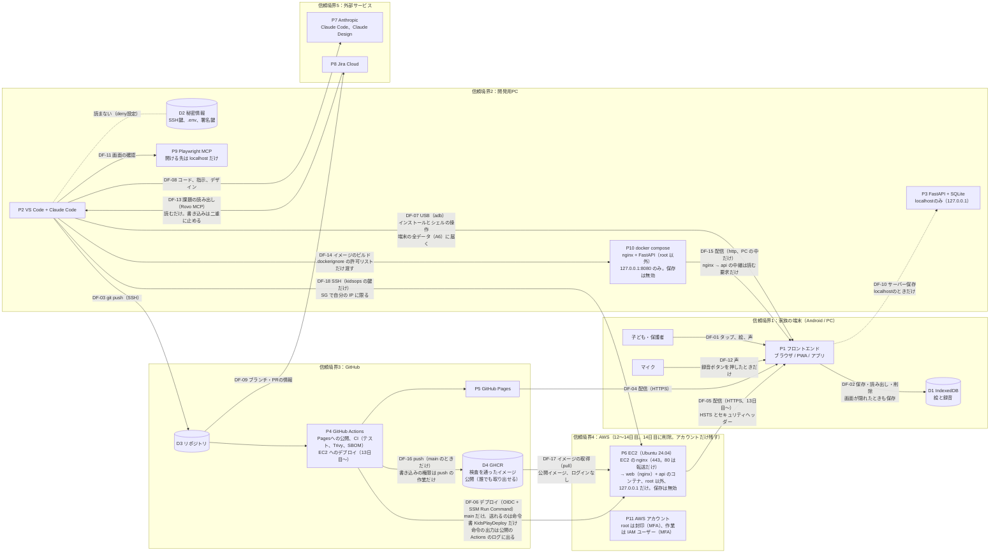

# 脅威分析（Threat Model）

初版（2026-10-09）。7日目（2026-10-14）に見直した（4章の「7日目の見直し」）。14日目（2026-10-28）に AWS を片付け、信頼境界4を廃止した（4章の「14日目の見直し」）。構成が変わる日（5日目、10日目、11日目、12日目）にも、該当する脅威を見直す（11日目は4章の「11日目の見直し」）。

- 手法：データフロー図 + STRIDE
- 対象：自分が管理するリポジトリ、アプリ、サーバーのみ

## 1. 保護すべき資産

| # | 資産 | なぜ守るか | 置き場所 | 重要度 |
|---|---|---|---|---|
| A1 | 子どもの絵と声 | 子どものプライバシー。流出すると取り返せない | 端末内（IndexedDB、おえかきの「ほぞん」で作るPNG：ブラウザとPWAはダウンロードフォルダ、Androidアプリ版は `Pictures/AsobiLand`）、localhostのSQLite | 高 |
| A2 | 秘密情報（AWS認証情報、SSH秘密鍵、DuckDNSトークン、署名鍵） | 悪用されるとサーバーの乗っ取りや課金につながる | 自分のPC、GitHub Secrets | 高 |
| A3 | サーバー（EC2）とAWSアカウント | 踏み台や不正利用、高額請求 | AWS | 高 |
| A4 | ソースコードと配布物の完全性 | 改ざんされたアプリが子どもの端末で動く | GitHub、GHCR、GitHub Pages | 中 |
| A5 | 子どもの安全な体験（聴覚、目、不適切な内容に触れないこと） | 大音量、激しい点滅、外部リンクや広告は、子どもに直接の害になる | フロントエンドの実装 | 高 |
| A6 | 開発に使う端末とPCにある、このアプリと関係のない個人のデータ（写真、動画、文書、ほかのアプリの画面） | 失うと取り返せない。開発の道具（adb、シェル）からは、アプリのデータと同じように手が届く | 家族のAndroid端末（内蔵と microSD）、開発用PC | 高 |

## 2. データフロー図

枠（subgraph）が信頼境界。枠をまたぐ矢印（DF-xx）が、脅威を探す主な場所になる。
⬜ はまだ作っていない要素（作る日）。7日目の見直しで実態に合わせる。

14日目に AWS のリソースを削除したので、P6、DF-05、DF-06、DF-17、DF-18 は今は存在しない（図は13日目の形のまま、記録として残す）。P11（AWS アカウント）だけが残る。

設計上の要点：DF-01、DF-02、DF-12 で扱う絵と声（A1）は、信頼境界1の外へ出る矢印を持たない。声の流れは「マイク → 録音（P1 の中の Blob）→ 保存（D1）→ 再生（P1 の Web Audio）」で、どこでも端末の外へ出ない。DF-10 は開発用PCの中だけで有効になる。

## 3. 脅威の洗い出し（STRIDE）

| STRIDE | 意味 | 車載での例 |
|---|---|---|
| **S**poofing | なりすまし | 不正なECUや診断機のなりすまし |
| **T**ampering | 改ざん | CANメッセージやファームウェアの改ざん |
| **R**epudiation | 否認 | 操作の記録が残らない |
| **I**nformation disclosure | 情報漏えい | 鍵や個人情報の読み出し |
| **D**enial of service | サービス拒否 | バスの占有 |
| **E**levation of privilege | 権限昇格 | 診断セッションの不正な昇格 |

STRIDEの当てはめ方（STRIDE per element）：データフロー（矢印）には T・I・D、プロセス（P）には6つすべて、データストア（D）には T・R・I・D、外部の人やサービスには S・R を当てて考える。

| ID | 対象（要素・データフロー） | STRIDE | 脅威シナリオ | 影響する資産 |
|---|---|---|---|---|
| T-01 | P1 フロントエンド、D1 | I、T | 画面に埋め込まれた悪意あるスクリプト（XSS）が、同じオリジンのIndexedDBから絵と録音を読み出し、外部へ送信する | A1 |
| T-02 | DF-08（Claude Code、Claude Design） | I | 指示やデザインの依頼文に、子どもの実名・写真・絵・声を含めてしまい、外部サービスに送信される | A1 |
| T-03 | DF-03（git push）、D3 | I | 秘密情報（.env、鍵、トークン）を誤ってコミットし、公開リポジトリに push する。履歴に残り、削除しても読める | A2、A3 |
| T-04 | D3、P4（依存パッケージ、Actionsの部品） | T | 取り込んだパッケージやGitHub Actionsの部品に悪意あるコードが入り、ビルドした配布物に混ざる（サプライチェーン） | A4、A1、A2 |
| T-05 | DF-04、DF-05（配信） | T、S | 配信の途中で内容を書き換えられる。または、よく似たURLの偽サイトに誘導され、改ざんされたアプリを使う | A4、A1、A5 |
| T-06 | P1（マイク、8日目〜） | I、E | 子どもが意味を分からずにマイクを許可する。許可が残り、意図しない場面で録音が始まる | A1 |
| T-07 | P6（EC2、12日目〜） | S、E、D | SSHへの総当たりや設定の不備からサーバーに侵入され、踏み台や暗号資産の採掘に使われる。高額な請求が発生する | A3 |
| T-08 | DF-10（サーバー保存） | I | 公開環境で、設定の誤りによりサーバー保存が有効になり、絵と録音がサーバーに送信される | A1 |
| T-09 | D1（IndexedDB） | I | 端末を家族以外が使う、または端末を手放すときに、残っていた絵と録音を見聞きされる | A1 |
| T-10 | P1（音、動き、画面の内容） | T（安全への影響） | 不具合や改ざんにより、急な大音量、激しい点滅、外部サイトへのリンクが子どもに届く | A5 |
| T-11 | P7、DF-08、DF-13（AIエージェント） | E、T | Claude Codeが読み込んだ外部の文章（Webページ、他者が作った部品の説明、MCP で読んだ Jira の課題の本文）に指示が埋め込まれ、意図しないコマンドの実行や秘密情報の読み出しにつながる（プロンプトインジェクション）。MCP の道具に書き込みの権限があると、読んだ指示どおりに Jira を書き換えられる | A2、A4 |
| T-12 | D3（リポジトリ） | R | 誰がいつ何を変えたかを追えず、問題のある変更の原因を特定できない | A4 |
| T-13 | P1（おえかきの「ほぞん」）、端末のダウンロードフォルダ（Androidアプリ版は、写真アプリに出る「ピクチャ」） | I | 保存したPNG（子どもの絵）が、端末の設定（写真アプリのクラウド同期、バックアップ）や共有の操作によって、端末の外に出る。アプリの境界の外で起こるので、アプリ側では止められない | A1 |
| T-14 | P1（Service Worker と、端末内の保存場所） | I、T | Service Worker が、残してはいけない応答（10日目以降のAPIの応答など）を端末に保存する。または、古いファイルを返し続けて、修正が端末に届かない | A1、A4 |
| T-15 | P5 GitHub Pages、D1、端末内の保存場所 | I、T | GitHub Pages のオリジン（`<ユーザー名>.github.io`）は、同じアカウントの他の Pages サイトと共有する。端末内の保存場所（IndexedDB、Cache Storage、localStorage）と CSP の `'self'` はオリジン単位なので、別のサイトのスクリプトが、このアプリの絵と録音を読み書きできる。逆に、このアプリの Service Worker が、別のサイトのキャッシュを消す | A1、A4 |
| T-16 | P7（AIエージェント）、開発用PCのシェル、adb、家族の端末 | T、I、E | Claude Code が、開発用PCのシェルから adb を通して、家族の端末を誤って操作する。USBデバッグを許可した端末は、PCからの操作をほぼ無条件に受け入れるので、アプリと関係のないデータの削除、ほかのアプリの操作、端末の画面の撮影ができてしまう。攻撃者がいなくても、エージェント自身の誤り（対象を確かめない削除、画面を見ない操作）だけで起こる。Claude Code の作業フォルダの制限は、ファイルを読み書きする道具にだけ効き、シェルのコマンドには効かない | A6、A1 |
| T-17 | Androidアプリ（Capacitor、WebView）、アプリの中の保存場所、Web から呼べるアプリ側の入口 | I、T、E | アプリの中のデータ（9日目からの絵と声）が、端末のバックアップや機種変更の転送で端末の外に出る。ひな形のままの広い設定（ほかのアプリにファイルを渡す入口、通信の権限）が、使っていないのに残る。えほんの録音のために足したマイクの権限が、録音していないときにも使われる、または通信の権限と組み合わさって声が外に出る。Web の画面から呼べるアプリ側の入口（保存）に、想定していない名前やデータを渡される。リリース版でデバッグ接続が有効のままになり、USB経由でアプリの中を読まれる | A1、A4 |
| T-18 | P3（PC 内の FastAPI）、DF-10 | S、T | 保護者が PC でサーバー保存を有効にしている間に、同じブラウザで開いた別のサイトのスクリプトが、PC 内のサーバーにページを送り込む（CSRF）。multipart の POST は事前の問い合わせなしで送られるので、CORS では止まらない。次に子どもがえほんを開くと、知らない絵と声が紙芝居として流れる。読み出し・削除・上書きは、CORS と事前の問い合わせで止まる | A1、A5 |
| T-19 | DF-14（イメージのビルド）、P10、GHCR（11日目〜） | I | イメージを作るときに、リポジトリのフォルダにある子どものデータ（`data/`、`backend/data/` の SQLite）や秘密情報（`.env`、鍵）がイメージに入る。イメージは GHCR に置かれ、公開のパッケージなら誰でも取り出して中を読める。`.gitignore` はイメージには効かないので、Git で守っていても漏れる。イメージのほかにも、コンテナから子どもや家族の情報が残る場所がある：nginx の一時ファイル（API が断る前に、送られた中身をためる）、アクセスログ（EC2 では家族の端末の IP と User-Agent が残る）、ビルドの記録（build-arg、provenance、レジストリに置くビルドのキャッシュ） | A1、A2 |
| T-20 | P10（コンテナ）、開発用PCと EC2 の docker | E、T | コンテナの中の弱点（nginx や Python の部品の脆弱性）を突かれたとき、コンテナが root や広い権限で動いていると、中身の書き換えやホストへの抜け出しにつながる。また、docker を使えるユーザー（`docker` グループ）は、コンテナを通して実質 root と同じことができる | A3、A4、A6 |
| T-21 | P11（AWS アカウント）、IAM ユーザー | S、E | AWS のサインイン情報（root、または AdministratorAccess を持つ IAM ユーザー）が盗まれ、アカウントを乗っ取られる。EC2 を大量に立てられて高額な請求が発生する、またはサーバーを書き換えられる。AWS の推奨は、人には一時的な認証情報（IAM Identity Center などのフェデレーション）を使うことだが、Identity Center で AWS アカウントの権限を配るには Organizations が要り、無料プランが有料プランに自動で上がるため、長く使う認証情報（IAM ユーザーのパスワード）を選んだ | A3 |
| T-22 | P4（CI）、P11（AWS）、P6（EC2）、DF-06（デプロイ） | E、T | CI（GitHub Actions）の部品の乗っ取りや、ワークフローの書き換えにより、デプロイ用のロールが悪用される。EC2 で root として任意のコマンドを実行される、または改ざんしたイメージに差し替えられる。13日目に自動デプロイ（OIDC と SSM Run Command）を足したことで、新しくできた経路 | A3、A4、A5 |
| T-23 | P6、P11、DuckDNS の名前、DF-06（廃棄の段階） | S、E、I | サーバーを片付けるときの残り物が悪用される。(1) Elastic IP を手放したあとも DuckDNS の名前が同じ IP を指していると、その IP を別の AWS の利用者が受け取ったときに、名前がその人のサーバーを指す（サブドメインの乗っ取り。家族に渡した URL やホーム画面の PWA が、他人のサイトを開く）。(2) 使わなくなったロール、OIDC の信頼、リポジトリの秘密の設定値が残り、あとで別の経路から悪用される。(3) 消し忘れたリソースが料金を発生させ続ける | A3、A4、A5 |

STRIDEの6分類のうち、T-10 は当てはまりが悪い。STRIDEは情報の安全（機密性・完全性・可用性など）の分類で、人への直接の害（聴覚、目）を表す項目がないため。ここでは「改ざん・不具合の結果」として T に置いた（6章の気づきを参照）。

## 4. リスク評価

影響度（高3・中2・低1）× 起こりやすさ（高3・中2・低1）で評価する。

| ID | 影響度 | 起こりやすさ | リスク値 | 対応方針（低減・回避・受容・共有） |
|---|---|---|---|---|
| T-01 | 3 | 1 | 3 | 低減（C-06、C-08） |
| T-02 | 3 | 2 | 6 | 回避（C-07。サンプルは自作SVGと合成音のみ） |
| T-03 | 3 | 2 | 6 | 低減（C-01、C-02、C-03） |
| T-04 | 3 | 1 | 3 | 低減（C-06 で公開物に依存を持たない。Actionsの部品は C-13 で固定。C-09） |
| T-05 | 3 | 1 | 3 | 低減（C-14。配信はHTTPSのみ） |
| T-06 | 3 | 2 | 6 | 低減（C-10） |
| T-07 | 3 | 2 | 6 | 低減（C-15）。請求は予算アラートで早く気づく |
| T-08 | 3 | 2 | 6 | 低減（C-12。既定で無効、テストで確認） |
| T-09 | 2 | 2 | 4 | 低減（C-11）＋受容（端末の画面ロックは家庭の運用に任せる） |
| T-10 | 3 | 2 | 6 | 低減（C-05、C-06） |
| T-11 | 3 | 2 | 6 | 低減（C-01、C-16） |
| T-12 | 1 | 1 | 1 | 受容（PRとコミットの履歴で追える。C-04） |
| T-13 | 3 | 2 | 6 | 低減（C-17）＋受容（端末の同期やバックアップの設定は家庭の運用に任せる） |
| T-14 | 3 | 1 | 3 | 低減（C-18） |
| T-15 | 3 | 1 | 3 | 回避＋低減（C-19） |
| T-16 | 3 | 1 | 3 | 低減（C-20）。2026-10-13 に実際に起きた（そのときの評価は 3 × 3 = 9）。7日目に、対策のあとの起こりやすさを 1 に下げた（下の「7日目の見直し」） |
| T-17 | 3 | 2 | 6 | 低減（C-21） |
| T-18 | 2 | 1 | 2 | 低減（C-22） |
| T-19 | 3 | 1 | 3 | 低減（C-23、C-12 の nginx の部分）。EC2 のアクセスログは journald で 14日・200MB まで（C-15。学習者の判断、12日目） |
| T-20 | 3 | 1 | 3 | 低減（C-13。EC2 の `docker` グループはだれも入れず、`sudo docker` をパスワードで守る（C-15）） |
| T-21 | 3 | 1 | 3 | 低減（C-24）＋受容（IAM ユーザーという長く使う認証情報。MFA で守る） |
| T-22 | 3 | 1 | 3 | 低減（C-25）。14日目に経路そのものを削除（C-26）。今は該当しない |
| T-23 | 3 | 2 | 6 | 低減（C-26）。片付けの順番を決めて、名前を先に消す |

起こりやすさを 1 としたものは、今の構成（外部のライブラリも通信もない静的なページ）が前提。構成が変わる日（5日目のPWA、10日目のAPI、11日目の依存パッケージ）に見直す。

5日目の見直し：公開物（`frontend/`）は、今も外部のライブラリを含まない。一方で、公開物を作る経路に GitHub Actions の部品が4つ入った（`pages.yml`）。部品はコミットIDで固定している（C-13）。開発用の道具（`package.json` の devDependencies 5つ）は、開発用PCで動くが、公開物には入らない。T-04 の起こりやすさは 1 のままにする。更新の取り込み方は C-09 で決めた（週1回、公開から7日待つ、PRで人が確認してからマージ）。T-15 の 1 は、「このアカウントで他の Pages サイトを公開しない」（C-19）が前提。

7日目の見直し（2026-10-14）：

- 2日目の初版との比較：資産 5 → 6、脅威 12 → 17、対策 16 → 21（実施済み・一部実施は 7 → 16）。追加した脅威のうち4つ（T-13、T-14、T-15、T-17）は、実装の途中で見つかった（保存、PWA、github.io の共有、Androidアプリ化）。机上の初版では出てこなかった。T-16 は事故のあとに加えた。初版は外の攻撃者だけを想定し、内側で動く道具の誤りを見ていなかった
- T-16 の起こりやすさを 3 → 1 にした。独立した層が4つ重なっている：(1) 危険な adb の操作を deny で止める、(2) `adb shell` は毎回、人が承認する（7日目に、承認の画面が出ることを確認。auto モードでも ask は人に確認を求める）、(3) 端末が、このPCからのUSBデバッグを許可していない（7日目に `device unauthorized` を確認。実機を使う日に許可し直すと、この層はなくなる）、(4) 使わないときはUSBケーブルを抜く。残るリスクは、人が承認の内容を読まずに許可すること。承認の画面では、コマンドの対象を読んでから許可する
- T-11 は、6日目に MCP（Playwright）を追加したので見直した。版を固定し、開ける先を localhost に限ったので、起こりやすさは 2 のままにする（C-16）
- 9日目（2026-10-17）に Atlassian Rovo MCP を読むだけで追加し、T-11 を見直した。Jira の課題の本文は、Claude にとって外部の文章になる。書き込みは、Atlassian 側と Claude Code 側の2か所で止めたので、読んだ指示で Jira が書き換わることはない。読める範囲も、自分の Jira（課題は学習者だけが書く）に限られる。起こりやすさは 2 のままにする

11日目の見直し（2026-10-22）：コンテナにしたことで、配布物にベースイメージの OS の部品（Alpine、Python、nginx）が入った。5日目の「公開物に外部の部品を持たない」という T-04 の前提は、コンテナの版では成り立たない。ベースイメージを版とダイジェストで固定し、Dependabot（docker）で更新を知らせる（C-09、C-13）。T-04 の起こりやすさは 1 のままにする。KIDS-38 で、Trivy が直し方のある CRITICAL を CI で止めることを確かめた（2021年のベースイメージに一時的に差し替えると、CRITICAL 8件で失敗し、GHCR へは push されなかった）。2026-10-22 の時点で、今のイメージは CRITICAL 0件。

CI の部品そのものも T-04 の経路になる。2026年3月に trivy-action のタグが乗っ取られ、CI の秘密情報を盗むコードが入った（CVE-2026-33634）。そこで、(1) 部品をコミットIDで固定し、(2) Trivy を動かす作業には書き込みの権限を渡さず、GHCR への書き込みは外部のスキャナーを動かさない別の作業に分けた。スキャナーが乗っ取られても、盗める権限は読むだけになる

12日目の見直し（2026-10-23）：EC2 を足し、信頼境界4が実体になった。

- T-07 の起こりやすさは 2 のままにする。SSH は鍵だけ・kidsops だけ・自分の IP だけに絞ったが、インターネットに 80 を開いたサーバーは、常に自動の攻撃にさらされる。また、家の IP アドレスが変わると SSH で入れなくなるので、そのときは SG を直す（広げて済ませない）
- Docker が外に出したポートは ufw の規則を通らない（Docker の公式の注意）。外に出すのは web の 80 だけにし、api は外に出さない。外からの通信の守りは、セキュリティグループ（AWS 側）が主になる。PC からポート 8000 に届かないことを確かめた
- ubuntu ユーザーには、パスワードなしの sudo が残っている（cloud-init の `90-cloud-init-users`）。ubuntu は SSH で入れない（`AllowUsers kidsops`）ので、残すリスクは小さいとして受け入れる。13日目に SSM を使うと、Agent が `ssm-user` を作り、パスワードなしの sudo を付ける。そのときに見直す。→ 13日目に見直した：`ssm-user` は Session Manager で最初に入ったときに作られる。自動デプロイの Run Command は root として動き、`ssm-user` を作らない。Session Manager はだれにも許可しないので、作られないまま（`id ssm-user` で、ないことを確かめた。C-25 (5)）
- 12日目は HTTP だけで配信している（T-05 の途中の改ざん）。HTTPS は13日目。それまで、この URL を家族に渡さない。えほんの録音は、ブラウザが HTTPS でないとマイクを使わせないので、HTTP の間は使えない
- 新しい脅威として T-21（AWS アカウントの乗っ取り）を足した。これまで C-15 にまとめていた AWS アカウントの守り（MFA、予算）を C-24 に分けた

14日目の見直し（2026-10-28）：AWS のリソースを片付けた（KIDS-49）。

- 信頼境界4のうち、EC2 と、それにつながる流れ（DF-05、DF-06、DF-17、DF-18）がなくなった。T-07（サーバーへの侵入）、T-22（デプロイの経路の悪用）は、今は該当しない。C-14、C-15、C-25 は、EC2 とともに役目を終えた（記録として残す）
- T-21（AWS アカウントの乗っ取り）は残る。アカウント、IAM ユーザー `kids-admin`、MFA、予算アラートを残したため（発展で使う）。無料プランなので、乗っ取られても請求は起こらないが、クレジットを使われる
- 廃棄の段階の脅威として T-23 を足した。21434 の14章（サイバーセキュリティのサポート終了と廃棄）に当たる。机上では気づきにくく、片付けの手順を考えたときに見つかった
- 公開の入口は GitHub Pages だけになった。README の AWS 版の URL は消した

## 5. 対策

| ID | 対策 | 対応する脅威 | 実施日 | 状態 | 確認方法（証拠） |
|---|---|---|---|---|---|
| C-01 | .gitignore と Claude Code の deny で秘密情報と子どものデータを除外 | T-03、T-11 | 1日目 | 実施済み | `.gitignore`、`.claude/settings.json` |
| C-02 | GitHubの Secret scanning と Push protection を有効化 | T-03 | 1日目 | 実施済み（アカウント側とリポジトリ側の両方で有効を確認） | アカウントとリポジトリの Settings |
| C-03 | SSH秘密鍵をパスフレーズで保護し、ssh-agent で管理 | T-03 | 1日目 | 実施済み | – |
| C-04 | Jira と GitHub の連携を kids-play のみに限定（最小権限）。変更はブランチ → PR → マージで記録を残す | T-12 | 1日目 | 実施済み | GitHub for Atlassian の設定画面、PRの履歴 |
| C-05 | 音の出口を1モジュールに集め、音量の上限・同時発音数・消音の確認をそこで行う | T-10 | 2日目 | 実施済み | `frontend/js/audio.js`（MASTER_VOLUME、MAX_VOICES） |
| C-06 | innerHTML を使わない。外部のスクリプト・フォント・画像・リンクを置かない。HTMLに style 属性を書かない | T-01、T-04、T-10 | 2日目 | 実施済み（検索で0件） | `frontend/` を innerHTML、style=、http で検索 |
| C-07 | 子どもの実名・写真・絵・声を、外部サービス（Claude、Jira、GitHub）に入力しないルール。反応の記録は個人を特定しない書き方にする | T-02 | 1日目 | 実施済み（運用） | `CLAUDE.md`、`docs/design.md` の反応メモ |
| C-08 | CSP（Content Security Policy）で、読み込み元を自分のオリジンに限定し、通信を禁止する。すべてのHTMLの meta タグに `default-src 'none'; script-src 'self'; style-src 'self'; img-src 'self'; manifest-src 'self'; worker-src 'self'; base-uri 'none'; form-action 'none'` を置く。meta タグでは指定できない項目（他サイトの枠への埋め込みの禁止 frame-ancestors、違反の報告）は、GitHub Pages では設定できないので、AWS版の nginx のヘッダーで行う（C-14）。13日目：AWS版では、EC2 の nginx のヘッダーに同じ CSP と `frame-ancestors 'none'`、`connect-src 'self'` を付けた（Service Worker には meta が効かず、ヘッダーだけが効くため。[day13-tls-zap.md](day13-tls-zap.md)）。違反の報告は入れない（送り先の API が、ブラウザから自分のサーバーへの新しいデータの流れになるため） | T-01、T-05 | 5日目（meta）、13日目（ヘッダー） | 実施（違反の報告は入れないと判断） | 各 `index.html` の先頭。画面なしのブラウザで、全画面とおえかきの「ほぞん」の違反が0件であること、HTMLに直接書いた script と style、外部への通信、外部の画像が止まることを確認 |
| C-09 | Dependabot と CodeQL を有効化。Dependabot は、脆弱性の通知（alerts）、脆弱性を直す更新（security updates）、新しい版への更新（version updates：npm と GitHub Actions。10日目に uv、11日目に docker のベースイメージを追加。週1回、公開から7日待つ）の3つ。CodeQL は default setup で、JavaScript とワークフローを、main への push・PR・週1回に解析する（10日目以降は Python、Java/Kotlin も対象。2026-10-28 に GitHub の API で、対象が actions・java-kotlin・javascript-typescript・python であることを確認）。更新のPRは、人が差分を確認してからマージする | T-04、T-01 | 5日目 | 実施済み（2026-10-12 の初回の解析：JavaScript 87ルール、ワークフロー 17ルールで指摘0件。Dependabot の通知0件） | リポジトリの Settings → Advanced Security、`.github/dependabot.yml`、Security タブ（Code scanning、Dependabot） |
| C-10 | マイクの許可は、録音ボタンを押したときだけ求める（音だけ。カメラは求めない）。録音中であることを画面に示す。止めたとき・30秒で自動で止まったとき・画面を離れたとき・画面が隠れたときに、マイクを手放す（画面を離れたときの録音は残さない） | T-06 | 8日目 | 実施（KIDS-30。Android アプリ版の権限は9日目） | `frontend/apps/storybook/recorder.js`、`tests/recorder.test.mjs`（許可を求める時期、30秒、手放す、cancel）。画面なしの Edge で、偽のマイクを使い、録音から再生までと外部への通信0件を確認 |
| C-11 | ページの削除と、全データの削除の機能。ページは2秒、全データは題名を5秒長押しする（保護者向け。子どもがうっかり消さないため） | T-09 | 9日目 | 実施（KIDS-31） | `frontend/apps/storybook/hold.js`、`tests/hold.test.mjs`、`tests/storage-indexeddb.test.mjs`。画面なしの Edge で、消したページと全データが、再読み込みのあとも消えたままであることを確認 |
| C-12 | サーバー保存は環境変数で切り替え、既定は無効（fail-safe）。無効のときAPIが拒否することをテストで確認。フロントも、PC 内の開発用サーバー（localhost の 8000 番、Android アプリの中ではない）のときだけサーバーに問い合わせる。CSP の通信先は自分のオリジンまで（えほんの画面だけ `connect-src 'self'`。13日目から、AWS 版ではヘッダーで全体に `connect-src 'self'` を付けた。ページの上では meta との重なりで、えほんだけになる。sw.js にはヘッダーの側が効く）。加えて、サーバーは 127.0.0.1 だけで待ち受け、Host が localhost / 127.0.0.1 以外の要求を拒否する（DNS リバインディング対策。docs/storage-interface.md）。11日目：nginx の後ろ（コンテナの版）では、API に届いてから断ると、その前に nginx が中身を一時ファイルにためてしまう。そのため nginx が `/api/` の書き込みの要求を中身を受け取る前に断り（`limit_except GET HEAD`、上限 1KB）、読む要求だけを中継する。12日目：EC2 では、読む要求も API の Host の確認で 400 になる（Host が公開の IP アドレスのため）。書き込みは nginx の 403、読み出しは API の 400 の2段で止まる | T-08 | 10日目、11日目（nginx）、12日目（EC2） | 実施 | pytest（無効なら保存APIがすべて 403、`enabled` 以外の値では有効にならない、よその Host は 400）。node:test（公開サイト・Androidアプリでは問い合わせない、無効・つながらない・遅いときは IndexedDB）。`npm run check:pwa`（connect-src はえほんの画面だけ）。画面なしの Edge で、有効のときはサーバーだけ・無効のときは端末の中だけに保存され、外への通信が0件 |
| C-13 | コンテナは小さいベースイメージと非root。Trivy と SBOM。GitHub Actionsの部品はバージョンを固定 | T-04、T-20 | 5日目（部品の固定）、11日目（コンテナ） | 実施（`pages.yml` の部品4つをコミットIDで固定。11日目（KIDS-37）：Alpine のベースイメージを版とダイジェストで固定。api は uid 10001、web は uid 101 で動く。ファイルの持ち主は root で、動くユーザーは書き換えられない。読み取り専用のファイルシステム、capabilities をすべて外す、no-new-privileges。api は PC の外に公開せず、web は 127.0.0.1:8080 だけ。動かす側のイメージに uv と pip を入れない。KIDS-38：CI で Trivy（v0.36.0 のアクション、本体 v0.76.0）が SBOM（CycloneDX）を作って成果物に残し、直し方のある CRITICAL があれば失敗させる。Trivy の作業は読むだけの権限で動かし、GHCR への push は検査したイメージそのものを別の作業で行う。`ci.yml` の部品もコミットIDで固定） | `.github/workflows/pages.yml`・`ci.yml`（`uses:` の行）、`docker/*.Dockerfile`、`compose.yaml`。`docker compose exec` で `id` が root 以外、`/app` と `/usr/share/nginx/html` に書けないことを確認。PR #58 の CI：緑（CRITICAL 0件）、SBOM は api 46・web 71 の部品。古いベースイメージでは CRITICAL 8件で赤 |
| C-14 | HTTPSのみで配信。HSTSなどのセキュリティヘッダー。EC2 では、HTTPS の入口を EC2 の nginx にし、証明書は Let's Encrypt（certbot、snap）。HTTP は HTTPS へ 301 で転送する。証明書の自動更新は certbot のタイマー。Let's Encrypt にはメールアドレスを登録しない（期限切れの通知は2025年に終了。個人の情報を外に出さない） | T-05 | 13日目 | 実施済み（HTTPS と転送、自動更新、セキュリティヘッダー） | PC から `http://` が 301、`https://` が 200 で証明書の検証が成功。EC2 で `certbot renew --dry-run` が成功、`systemctl list-timers` に `snap.certbot.renew.timer`。SSL Labs で A+、ZAP のベースラインで FAIL 0（[day13-tls-zap.md](day13-tls-zap.md)）。`server/nginx/kids-play.conf` |
| C-15 | サーバーのハードニング。(1) SG：SSH（22）は自分の IP（/32）だけ、HTTP（80）だけを全体に開く。(2) SSH：鍵（ED25519）だけ。root・パスワード・キーボード対話式のログインを禁止。入れるのは作業用の `kidsops` だけ（`AllowUsers`）。試行は3回まで、X11 転送なし（`/etc/ssh/sshd_config.d/10-kids-play.conf`。cloud-init の 60 番より先に読ませる）。初めての接続では、サーバーの鍵の指紋を EC2 のシステムログと照らし合わせた。(3) `kidsops` の sudo はパスワードが要る（鍵が盗まれても、すぐには root にならない）。`docker` グループにはだれも入れない（T-20）。(4) ufw：外から来る通信は断り、22（LIMIT）と 80 だけ許可。(5) unattended-upgrades でセキュリティの更新を毎日入れる。(6) IMDSv2 を必須（ホップ制限 1、メタデータのタグは無効）。(7) EBS を暗号化。(8) t3 のクレジット仕様を「標準」にし、CPU を使い続けても追加料金にならないようにする。(9) コンテナのログを journald に送り、14日・200MB で消す（T-19）。journald はファイル単位で消すので、ファイルを1日ごとに切り替える（`MaxFileSec=1day`。privacy-reviewer の指摘）。(10) EC2 の `/opt/kids-play` には `compose.yaml` だけを置き、`.env` や上書きファイルを置かない（compose が断りなく読み込み、サーバー保存の環境変数が入る経路になるため。C-23 と同じ決まり）。起動の前に `docker compose config` で `environment` がないことを確かめる。OIDC（アクセスキーなし）は13日目。(11) 13日目に HTTPS（443）を SG と ufw に足した。外で待つのは EC2 の nginx だけにし、web のコンテナは `127.0.0.1:8080` だけで待つ（Docker が外に出したポートは ufw を通らないため）。EC2 の nginx も、読む要求（GET、HEAD）だけを通し、書き込みは中身を受け取る前に断る（C-12 の nginx の部分を、前に置いた nginx でも守る） | T-07、T-19、T-20、T-08 | 12〜13日目 | 一部実施（(1)〜(10) を12日目に、(11) を13日目に実施。OIDC と SSM は13日目） | EC2 の bash で読むだけの点検（`sshd -T`、`ufw status`、`apt-config dump`、トークンなしの IMDS が 401、`ss -tlnp` で外は 22 と 80 だけ、`getent group docker` が空、root のパスワードがロック）。PC から ubuntu で入れないこと（`Permission denied`）、ポート 8000 に届かないこと。AWS の画面で SG、IMDSv2、暗号化、クレジット仕様。`server/compose.yaml`、`server/journald/10-kids-play.conf` |
| C-16 | Claude Codeが外部から読んだ文章は、指示ではなくデータとして扱う。外部サービスの操作と push は実行前に確認する。MCPは最小権限 | T-11 | 1日目（確認のルール）、6日目（MCP） | 一部実施（MCP は2つ。Playwright：版を 0.0.83 に固定し、開ける先を localhost:8000 に限定。Atlassian Rovo MCP（9日目）：読むだけ。鍵は2つ。(1) Atlassian の管理画面で読み取りを `read_jira` だけ許可し、書き込み・検索・削除・管理は0、新しい道具の自動許可もオフ。サインインの同意で求められた権限は Read だけ。(2) Claude Code の deny で `executeWrite` と `executeDestructive` を止める） | `CLAUDE.md`、`.claude/settings.json`、`.mcp.json`、Atlassian の管理画面（Rovo MCP サーバー → 権限） |
| C-17 | おえかきの保存は、端末へのダウンロードだけにする（通信しない）。ファイル名には日時だけを入れ、個人が分かる情報を入れない。保存先が端末内であることと、同期やバックアップの設定への注意を、READMEの保護者向けの説明に書く | T-13 | 4日目（実装）、5日目（README） | 実施済み | `frontend/apps/draw/draw.js`（fileName、ほぞんの処理）、`README.md` のプライバシー方針。操作中の外部への通信が0件であることを、画面なしのブラウザで確認 |
| C-18 | Service Worker が保存するのは、`sw.js` の一覧に書いた公開物だけにする（許可リスト）。一覧にない要求には手を出さず、そのままネットワークへ通す。保存した分は、開くたびに裏で取り直して入れ替える。PC内のサーバーでは登録しない | T-14 | 5日目 | 実施済み | `frontend/sw.js`、`npm run check:pwa`（一覧と実際のファイルのずれを検出）。画面なしのブラウザで、保存が27件であること、サーバーを止めても5画面が開くこと、一覧にない要求では保存が増えないことを確認 |
| C-19 | このアカウントでは、他の GitHub Pages サイトを公開しない（公開する場合は、中身を自分で管理する静的なページだけにする）。Service Worker が消すキャッシュは、`kids-play-` で始まる名前に限定する。9日目（IndexedDB に絵と録音を入れる日）の前に、他の Pages サイトがないことを確認する | T-15 | 5日目（sw.js）、9日目（確認） | 実施（sw.js の限定は KIDS-51 で実施。2026-10-16、IndexedDB を使い始める前に、自分のリポジトリのうち Pages が有効なものは kids-play だけで、`<ユーザー名>.github.io` のリポジトリもないことを確認） | `frontend/sw.js`（activate の処理）。画面なしのブラウザで、別の名前のキャッシュが残り、`kids-play-` の古いキャッシュだけが消えることを確認。GitHub の API（自分のリポジトリのうち `has_pages` が true のもの）で、Pages の一覧を確認 |
| C-20 | AIエージェントが実機に届く経路を、仕組みで絞る。(1) adb 経由の削除・書き換え（`content delete`、`rm`、`-delete` など）、入力の送信（`input`）、端末の画面の撮影（`screencap`）を、Claude Code の deny で止める。(2) `adb shell` で始まるコマンドは、毎回、人の承認を求める（ask）。(3) 実機の画面の確認は、アプリの WebView へのデバッグ接続（アプリの中身だけが取れる）で行い、音・指の操作・端末の見た目は人が確かめる。(4) 確認で端末に作ったファイルの後片づけは、人が行う。(5) 実機を使わないときはUSBケーブルを抜き、作業のあとはUSBデバッグをオフにする。(6) 実機をつなぐ前に、端末の大事なデータのバックアップがあることを確かめる | T-16 | 6日目 | 一部実施（(1)(2) を設定。(2) は7日目に、承認の画面が出ることを確認。(3)(4) は運用。(5)(6) は学習者の運用） | `.claude/settings.json`（deny と ask の adb の行）。deny は書き方を変えたコマンドまでは防げないので、(2) の承認と重ねる |
| C-21 | Androidアプリの設定を最小にする。(1) バックアップと機種変更の転送を無効にする（`allowBackup="false"` に加えて、Android 12 以上の `dataExtractionRules` と、Android 11 以下の `fullBackupContent` で、全データを対象から外す）。(2) 権限は、マイクの2つ（`RECORD_AUDIO`、`MODIFY_AUDIO_SETTINGS`）だけにする。えほんの録音に使う。Capacitor 8.5.3 は、WebView がマイクを求めたときに両方を求め、どちらかがないと拒否する。許可を求めるのは録音ボタンを押したときだけ。`INTERNET` は外したまま（画面のファイルはアプリの中にあり、録音した声を外に送る手段がない）。(3) ひな形の FileProvider を外す。(4) Web から呼べる入口は `PictureSaver` の1つだけにし、ファイル名の形・大きさ・PNGであることを確かめる。(5) 署名鍵は、リポジトリの外に置く（`.gitignore` で二重に除外）。リリース版は作っていないので、鍵はまだない。(6) WebView のデバッグ接続は、Capacitor の既定（開発中だけ有効）のままにする。リリース版を作るときに、無効であることを確かめる | T-17、T-13 | 6日目 | 一部実施（(1)〜(5) を実施。(6) は、リリース版を作るときに確認。(2) のマイクの権限は、9日目（KIDS-32）のビルドで、APK の権限がマイクの2つだけ（INTERNET なし）であることと、実機の録音を確認した） | `android/app/src/main/AndroidManifest.xml`、`res/xml/data_extraction_rules.xml`、`res/xml/backup_rules_legacy.xml`、`PictureSaverPlugin.java`。APK の中のマニフェストを aapt2 で読み、権限が自分用の1つだけ、`allowBackup=false`、FileProvider がないことを確認。実機で、権限なしでも5画面が開くこと、保存の入口が不正な入力を断ることを確認 |
| C-22 | PC 内のサーバーは、書き込みの要求（POST・PUT・DELETE）を、Origin が自分自身（`http://` ＋ 確認済みの Host）のときだけ受け付ける。Origin がない要求も断る（ブラウザは書き込みに必ず付けるため）。読むだけの要求には CORS の許可を出さない | T-18 | 10日目 | 実施 | pytest（よそのサイト・`null`・Origin なし・Host と違う Origin の書き込みは 403、自分自身なら保存できる）。画面なしの Edge で、同じサイトからの保存はこれまでどおり動く |
| C-23 | イメージに渡すファイルを `.dockerignore` の許可リストで決める（まず全部を除き、`frontend/`、`backend/app/`、`backend/pyproject.toml`・`uv.lock`、`server/nginx/` だけを戻す）。書き忘れた新しいファイルは、入らない側に倒れる。許可したフォルダの中に Git の外のファイル（録音、画像、DB、`.env`、鍵、ログ）を誤って置いても入らないよう、念のための除外も書く。コンテナの版では、サーバー保存の環境変数を渡さない（T-08 の対策 C-12 と同じ形）。compose の上書きファイル（`compose.override.yaml`）は、断りなく自動で読まれるので置かない。設定を変えたら `docker compose config` で、合わさった最終の設定を確かめる。KIDS-38 で決めたこと：GHCR へ push するのは CI で検査したイメージだけ（手元の `:local` は push しない）。build-arg は使わない。イメージは `docker save` で受け渡すので、ビルドの記録（provenance）は付かない。レジストリにビルドのキャッシュは置かない。GHCR のパッケージは公開（誰でも取り出せる）。ワークフローが `GITHUB_TOKEN` で作ったパッケージは、リポジトリの公開範囲を引き継ぐので、公開のリポジトリから作ると最初の push で公開になる（非公開には戻せない）。中身は公開リポジトリにあるものと OS・Python の部品だけなので、学習者の判断で公開のままにした。そのため、イメージに入るものの制限（この対策）が、公開してよいかどうかの唯一の歯止めになる | T-19、T-08 | 11日目 | 実施 | `.dockerignore`。イメージの中に `/app/data` がなく、web には公開物の種類（html、css、js、svg、png、webmanifest）だけがあることを `docker compose exec` で確認。`/api/storage/status` が `{"enabled":false}`。保存の API は nginx が 403（大きな中身は 413）で断り、api には届かない（api のログに書き込みの要求が0件） |
| C-24 | AWS アカウントの守り。(1) 無料プランにする（請求が起こらない。Organizations は使わない。使うと有料プランに上がる）。(2) root は MFA（認証アプリ）を付けて封印し、アクセスキーは作らない。(3) 日常の作業は IAM ユーザー `kids-admin`（AdministratorAccess のグループ `admins`）。MFA を付け、アクセスキーは作らない。(4) 予算アラートを2つ（ゼロ支出、月 $15）。(5) 請求情報への IAM のアクセスを有効にし、IAM ユーザーでクレジットと予算を見られるようにする。最小権限は、人ではなく、13日目に GitHub Actions と EC2 に渡すロールで徹底する | T-21、T-07 | 12日目 | 実施 | AWS の画面：root と kids-admin の MFA が各1件、アクセスキーが0件。kids-admin でのサインインで MFA を求められた。Budgets に2件。無料プランの残り（$100、183日） |
| C-25 | 自動デプロイの最小権限。(1) GitHub Actions は OIDC でその場かぎりの認証情報を受け取り、AWS のアクセスキーを作らない。(2) デプロイ用ロール `kids-play-github-deploy` の信頼ポリシーは、`aud` が `sts.amazonaws.com`、`sub` が `repo:Hayato-F110@226114657/kids-play@1410155943:ref:refs/heads/main` のときだけ（PR やほかのブランチ、フォークからは引き受けられない）。このリポジトリは、GitHub が `sub` に、アカウントとリポジトリの変わらない ID を付けて送る設定（`use_immutable_subject`）になっている。名前だけで判定すると、リポジトリを消したあとに別の人が同じ名前で作り直したときに引き受けられてしまうが、ID 付きならそれを防げる（最初は名前だけで書き、最初のデプロイが断られて気づいた）。(3) ロールにできるのは、命令書 `KidsPlayDeploy` をこのインスタンスに送ることと、結果を読むことだけ。任意のシェル（`AWS-RunShellScript`）や Session Manager は許さない。(4) 命令書の引数は `Tag` だけで、`^sha-[0-9a-f]{40}$` の形しか通さない（命令の中に別のコマンドを混ぜさせない）。中身は、環境変数のファイルと上書きファイルがないことと、`compose config` に `environment` がないことの確かめ（C-15 (10)）、`-f compose.yaml` での pull と up、起動の確認（失敗したら前の版に戻す）、動いている版の記録（`deployed-tag`）、古いイメージの削除だけ。(5) EC2 のロール `kids-play-ec2-ssm` は `AmazonSSMManagedInstanceCore` だけ。Session Manager を使わないので、パスワードなしで sudo を使える `ssm-user` は作られない（13日目に `id ssm-user` で、ないことを確かめた）。(6) ワークフローの deploy は `id-token: write` と `contents: read` だけ。部品はコミット ID で固定（C-13）。デプロイは同時に1つだけ。失敗したときのログでアカウント ID を伏せる（`mask-aws-account-id`）。(7) 受け入れたこと：結果を読む `ssm:GetCommandInvocation` はリソースを絞れないので `*`（同じアカウントのほかのコマンドの出力も読める）。イメージはダイジェストではなくタグで指す（タグを書き換えられるのは、GHCR に書ける push の作業だけで、その作業は検査済みのイメージしか扱わない）。命令の出力（`docker compose ps` など。子どものデータは含まない）は、SSM と公開の Actions のログに残る。今後 main で動くワークフローに `id-token: write` を足すと、そのワークフローもこのロールを引き受けられる（足すときは environment で絞る） | T-22、T-03、T-07 | 13日目 | 実施 → 14日目に廃止（EC2 とロールを削除、CI から deploy を外した。#76）（#66、#67 のマージで deploy が緑、EC2 の `deployed-tag` が一致） | `server/aws/`（命令書、信頼ポリシー、許可ポリシー。アカウント ID とインスタンス ID は書かない）。`.github/workflows/ci.yml` の deploy。main へのマージで deploy が緑になり、EC2 で `sha-<コミットID>` が動くこと |

| C-26 | 片付け（廃棄）の手順。(1) 名前を先に消す：DuckDNS のドメインを、Elastic IP を手放す前に削除した（T-23 (1)）。(2) CI から deploy の作業を外してから、権限を消す（#76。外さないと、main へのマージのたびに失敗する）。(3) EC2 を終了 → Elastic IP を解放 → ボリューム・スナップショット・セキュリティグループ・キーペア → SSM の命令書 → IAM ロール2つ → OIDC プロバイダー → リポジトリの秘密の設定値2つ、の順に消した。(4) 料金とグローバルビューで、残り物がないことを確かめた。(5) 残したもの：AWS アカウント（無料プラン）、IAM ユーザーと MFA、予算アラート、GHCR のイメージ（16日目の署名で使う） | T-23、T-22、T-07 | 14日目 | 実施 | PC から名前が引けない（`DNS 名がありません`）。EC2 のグローバルビューで、全リージョンのボリューム・Elastic IP・S3 バケットが0（インスタンスは終了済みが一時的に1と表示）。請求は USD 0.00（無料プランのクレジットから約 $2.20） |

## 6. ISO/SAE 21434（TARA）との対応

| ISO/SAE 21434 の活動（15章） | この文書での対応 | 違い・気づき |
|---|---|---|
| アイテム定義（9.3） | 対象範囲、データフロー図 | 車載のアイテム境界に当たるのが信頼境界。Webでは境界の外（ブラウザ、他人のサーバー、依存パッケージ）が広く、自分で管理できない要素が多い |
| 資産の識別（15.3） | 1. 保護すべき資産 | 21434は資産にサイバーセキュリティ特性（C・I・A）を付けてダメージシナリオを導く。ここでは「なぜ守るか」の列がダメージシナリオに当たる |
| 脅威シナリオの識別（15.4） | 3. 脅威の洗い出し（STRIDE） | STRIDEは要素ごとに6分類を機械的に当てるので、漏れを減らせる。21434は手法を指定しないので、TARAの中でSTRIDEを使うこともできる |
| 影響度の評価（15.5） | 4. リスク評価（影響度） | 21434はSFOP（安全・財務・運用・プライバシー）。ここでは主にプライバシーと財務。A5（子どもの聴覚と目）だけが S（安全）に当たり、STRIDEでは表しにくい |
| 攻撃経路の分析（15.6） | 3. の脅威シナリオ | 攻撃ツリーまでは作らず、シナリオの文に経路を含めた。規模が小さいための簡略化 |
| 攻撃の実現可能性の評価（15.7） | 4. リスク評価（起こりやすさ） | 21434の攻撃ポテンシャル（時間、専門知識、機会、機器など）を、3段階の「起こりやすさ」1つに簡略化した。インターネットに公開するので「機会」は常に高い、という点が車載と大きく違う |
| リスク値の決定（15.8） | 4. リスク値 | 影響度 × 起こりやすさ（1〜9）。21434のリスクマトリクス（1〜5）に当たる |
| リスク対応の決定（15.9） | 4. 対応方針、5. 対策 | 低減・回避・受容・共有の4つは同じ。T-02（子どもの情報を入れない）は「回避」の例 |
| （範囲の外）意図しない誤操作 | T-16 | 21434 は、攻撃者による意図的な攻撃を前提にする。攻撃者のいない、道具（AIエージェント）の誤りは、TARA の枠に入りにくい。車載で言えば、機能安全（ISO 26262）の系統的故障やツールの信頼性（ツール信頼度）に近い。ここでは、資産への害が同じなので、脅威として同じ表で扱った |
| サポート終了と廃棄（14章） | T-23、C-26 | 車載では、サポートを終えた車両や ECU の鍵・診断の入口を、どう扱うかを決めておく。ここでは、サーバーを消すときの「名前の消し忘れ」と「権限の消し忘れ」が、新しい攻撃の入口になった。作るときの手順と同じように、消すときの順番も設計が要る |
| サイバーセキュリティ目標・要求（9.4、9.5） | 5. 対策 | 対策に「確認方法（証拠）」の列を付け、要求と検証の対応を残した。21434の検証・妥当性確認に当たる |

## 7. 見直しの履歴

| 日付 | 変更内容 | きっかけ |
|---|---|---|
| 2026-10-08 | 雛形を作成。資産A1〜A4と対策C-01、C-02を仮置き | 1日目 |
| 2026-10-09 | 初版。資産A5、データフロー図（信頼境界5つ、DF-01〜DF-10）、脅威T-01〜T-12、リスク評価、対策C-05〜C-16、TARAとの対応を追加 | 2日目。Claude Designの使い方の変更（DF-08）と、音の実装（C-05）を反映 |
| 2026-10-11 | 脅威T-13（保存したPNGが端末の外に出る）と対策C-17を追加 | 4日目。おえかきスタンプの「ほぞん」を実装し、/sec-check で見つけた。アプリの境界の外の扱いなので、運用への前提として書いた |
| 2026-10-12 | 対策C-08（CSP）を meta タグで実施。meta タグで指定できない項目を C-14 に回した | 5日目。GitHub Pages で公開した。Pages では応答ヘッダーを設定できない |
| 2026-10-12 | 脅威T-14（Service Worker の保存範囲と、古いファイル）と対策C-18を追加。C-08 のCSPに manifest-src と worker-src を追加 | 5日目。PWA化で、端末内に新しい保存場所ができた |
| 2026-10-12 | 脅威T-15（github.io のオリジンを他の Pages サイトと共有する）と対策C-19を追加。図の P4・P5 を実態に合わせた。T-04 の前提、C-13、C-17 の状態を更新。A1 の置き場所にダウンロードフォルダを追加 | 5日目。レビュー用サブエージェント（privacy-reviewer）の指摘 |
| 2026-10-12 | 対策C-09（Dependabot と CodeQL）を実施。T-04 の更新の取り込み方を決めた | 5日目。公開物を作る経路に GitHub Actions の部品が入ったため |
| 2026-10-13 | 脅威T-17（Androidアプリの設定と、Web から呼べる入口）と対策C-21を追加。A1 の置き場所と T-13 に、Androidアプリ版の保存先（ピクチャ）を追加 | 6日目。Capacitor でAndroidアプリにした。ひな形は、バックアップが有効で、ファイルを渡す範囲が広かった。WebView がダウンロードを受け取らないので、保存の入口を自分で作った |
| 2026-10-13 | 資産A6（開発に使う端末とPCにある、アプリと関係のない個人のデータ）、脅威T-16（AIエージェントが adb 経由で実機を誤って操作する）、対策C-20を追加 | 6日目。Claude Code が、実機の確認中に2回、端末を誤って操作した。1回目は、画面を確かめない座標のタップで、ほかのアプリを操作し、端末のホーム画面を撮影した。2回目は、確認用の画像1枚を消すつもりのコマンドの誤りで、端末の画像（内蔵と microSD）をすべて削除した。これまでの脅威分析は外からの攻撃者を想定していて、内側で動くエージェントの誤操作を脅威として扱っていなかった |
| 2026-10-14 | 7日目の見直し。T-16 のリスク値を 9 → 3 に（対策のあとの評価）。データフロー図に P9（Playwright MCP）と DF-11 を追加し、DF-07 を「インストールとシェルの操作」に広げた。C-16、C-20 の状態を更新。TARA との対応に、意図しない誤操作の行を追加。2日目の初版との比較を4章に記録 | 7日目（スプリント1の締め）。`adb shell` で承認の画面が出ることを確認した |
| 2026-10-16 | D1（IndexedDB）を実装した。データの流れの図にマイクと DF-12 を足し、DF-02 に削除と「画面が隠れたときの保存」を足した。C-11 を実施に、C-19 を確認済みにした | 9日目。KIDS-31。privacy-reviewer の指摘（C-11 を IndexedDB と同時に入れる、図に新しい流れを足す、C-19 の確認を記録する） |
| 2026-10-16 | C-21 (2) を「権限は、なし」から「マイクの2つだけ（`RECORD_AUDIO`、`MODIFY_AUDIO_SETTINGS`）。`INTERNET` はなし」に変えた。T-17 にマイクの権限の脅威を足した | 9日目。KIDS-32。Androidアプリ版で、えほんの録音を使えるようにするため。Capacitor 8.5.3 は、マイクの要求に2つの権限の両方を求める |
| 2026-10-17 | データの流れの図に DF-13（Jira の課題の読み出し、Rovo MCP）を追加。T-11 に MCP で読む Jira の本文を加え、C-16 に Atlassian Rovo MCP（読むだけ、鍵は2つ）を追記 | 9日目。7日目に「Jira の MCP は入れない」と決めたが、読むだけに限れば書き込みの権限を AI に渡さずに済むので、学習者の判断で入れた |
| 2026-10-21 | P3（FastAPI + SQLite）と DF-10 を実装した。C-12 を実施にし、四つめの対策（127.0.0.1 だけで待ち受け、よその Host を拒否）を足した | 10日目。KIDS-34。サーバー保存は PC の中だけで使う |
| 2026-10-21 | 脅威 T-18（PC 内のサーバーへの CSRF）と対策 C-22 を追加し、実施した | 10日目。KIDS-35。/security-review の指摘（確信度 8/10）。T-08 は「送ってしまう」側だったが、API を足したことで「受け取ってしまう」側の脅威が新しくできた |
| 2026-10-22 | データの流れの図に P10（docker compose）、DF-14（イメージのビルド）、DF-15（PC の中の配信）を追加。脅威 T-19（イメージに子どものデータや秘密情報が入る）、T-20（コンテナの権限、docker グループ）と、対策 C-23 を追加。C-13 を更新。4章に11日目の見直しを追記 | 11日目。KIDS-37。WSL2 と Docker Desktop を入れ、nginx と FastAPI をコンテナにした。Ubuntu のユーザーが `docker` グループに入ったことで、T-20 に気づいた |
| 2026-10-22 | C-12 に nginx の部分（書き込みを中身を受け取る前に断る）を追加。T-19 に nginx の一時ファイル、アクセスログ、ビルドの記録を追加。C-23 に念のための除外、compose の上書きファイル、KIDS-38 で決めることを追加 | 11日目。KIDS-37。privacy-reviewer の指摘（中1件、低3件）。10日目の「中身を読む前に断る」は、前に nginx を置くと成り立たなくなっていた |
| 2026-10-22 | データの流れの図に D4（GHCR）と DF-16（push）を追加し、P4 を CI に広げた。C-13 を実施に、C-23 の KIDS-38 の分を実施にした。4章の11日目の見直しに、Trivy で止まることの確認と、CI の部品の乗っ取り（trivy-action の事件）への対策を追記 | 11日目。KIDS-38。GitHub Actions の CI と GHCR を足した |
| 2026-10-22 | D4（GHCR）と C-23 を「非公開」から「公開」に直した | 11日目。main の CI で最初に push したとき、パッケージがリポジトリの公開範囲を引き継いで公開になった（ログインなしで取り出せることを確認）。「既定は非公開」というドキュメントの記述を根拠に、push の前に公開範囲を確かめていなかった。非公開には戻せないので、中身（公開リポジトリと同じもの）を確かめたうえで、学習者の判断で公開のままにした |
| 2026-10-23 | データの流れの図の信頼境界4を実体にし、P11（AWS アカウント）、DF-17（イメージの取得）、DF-18（SSH）を追加。DF-05 を「12日目は HTTP」に。脅威 T-21（AWS アカウントの乗っ取り）と対策 C-24 を追加。C-15 を一部実施に、T-19 と T-20 の EC2 の分を決めた。4章に12日目の見直しを追記 | 12日目。KIDS-39・40・41。AWS のアカウントを作り、EC2 にハードニングをしてから、GHCR のイメージで HTTP の配信を始めた。IAM ユーザーは AWS の推奨（フェデレーション）から外れるので、受け入れたリスクとして記録した |
| 2026-10-24 | C-14 を実施に（HTTPS、転送、自動更新、セキュリティヘッダー）、C-08 を実施に（ヘッダーの frame-ancestors。違反の報告は入れない）。C-12 にヘッダーの connect-src を、C-15 に (11)（443、コンテナは 127.0.0.1 だけ、前に置いた nginx でも書き込みを断る）を追加 | 13日目。KIDS-42・44。SSL Labs で A+、ZAP のベースラインで FAIL 0（[day13-tls-zap.md](day13-tls-zap.md)）。privacy-reviewer の指摘（中1件、低3件） |
| 2026-10-24 | 脅威 T-22（自動デプロイの経路の悪用）と対策 C-25 を追加し、実施した。データの流れの図の P4、P6、DF-05、DF-06 を13日目の形（HTTPS、EC2 の nginx、OIDC と SSM）に更新 | 13日目。KIDS-43。OIDC と SSM の自動デプロイを足した。ロールには、専用の命令書を送ることだけを許した（学習者の判断） |
| 2026-10-28 | 脅威 T-23（廃棄の段階の残り物）と対策 C-26 を追加し、実施した。信頼境界4を廃止し、T-07・T-22 を「今は該当しない」に、C-25 を廃止にした。TARA との対応に14章の行を追加。4章に14日目の見直しを追記 | 14日目。KIDS-49。AWS を片付けた。手順を考えたときに、DuckDNS の名前が手放した IP を指したまま残る危険に気づき、名前を先に消した |
| 2026-10-24 | C-25 (2) の `sub` を、変わらない ID 付きの形に直した | 13日目。KIDS-43。最初のデプロイで、ロールの引き受けが断られた。GitHub の API（`actions/oidc/customization/sub`）で、このリポジトリが ID 付きの `sub` を送る設定だと確かめた |
