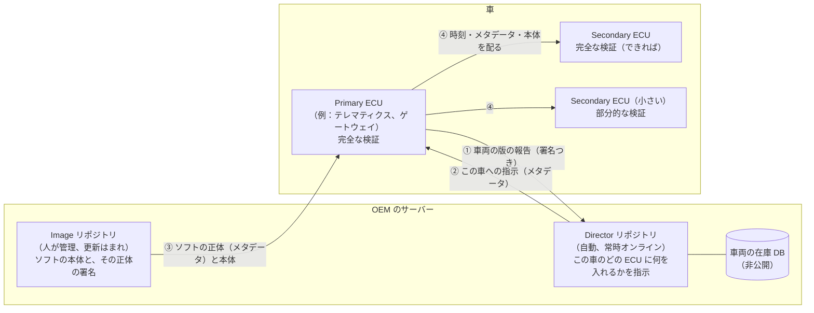

# Uptane：車両全体のソフトウェア更新の守り

21日目（KIDS-65）。Uptane Standard 2.1.0（2023年6月）を Claude が読み、日本語の図と説明にした。
仕様の文章は転載せず、自分の言葉でまとめている（仕様は Community Specification License 1.0。章の番号を添える）。
学習者は内容を確かめて判断する。

## ひとことで

**サーバーが1つ破られても、車に偽物や古いソフトを入れさせない**ための、OTA 更新の枠組み。
鍵とサーバーを2つに分け、車の側で両方の言い分が一致するときだけ入れる。

## 全体の図

## 2つのリポジトリと役割の分け方（5章）

| | Image リポジトリ | Director リポジトリ |
|---|---|---|
| 何を言うか | 「このファイルは正規のソフトで、ハッシュと大きさはこれ」 | 「この車のこの ECU には、このソフトを入れよ」 |
| 管理 | 人が管理し、更新はまれ | 自動で、車ごとにその場で署名する |
| 破られたら | 偽物のソフトを「正規」と言える。でも Director が指示しない | 偽物を入れろと指示できる。でも Image が「正規」と言っていない |

どちらのリポジトリも、4つの役割の署名を持つ（TUF という仕組みの役割を使う）。

| 役割 | 署名するもの | 防ぐ攻撃 |
|---|---|---|
| Root | ほかの役割の公開鍵と、必要な署名の数（しきい値）。鍵の失効も | 鍵の入れ替えの乗っ取り |
| Targets | ソフトのファイル名、大きさ、ハッシュ（Director は ECU の ID も） | 任意のソフトの導入 |
| Snapshot | その時点で公開している Targets の版の一覧 | 異なる時点の組み合わせ（mix-and-match） |
| Timestamp | Snapshot のハッシュと版。新しいものがあるかを短い期限で示す | 古いままにする攻撃（freeze） |

仕様は、どの鍵をオンラインに置くかまでは決めていない。Image は人が管理する、Director は自動でオンライン、という性格だけを示している。

## 車の中：Primary と Secondary（5.4）

- **Primary**：全体をまとめる ECU。**完全な検証**が必須：2つのリポジトリの4役割をすべて確かめ、最後に **Director と Image の Targets が一致するか**を見る（ここが要。片方だけ破られても一致しない）
- **Secondary**：できれば完全な検証。資源が足りなければ、最低でも**部分的な検証**（時刻と、Director の Targets だけ）
- 工場で入れておくもの：検証に使う Root などのメタデータと、ECU ごとの固有の鍵

## 更新の流れ（車の側）

1. Primary が、各 ECU の版の報告をまとめ、署名して Director に送る（車両の版の報告）
2. 安全な時刻を得る（期限切れのメタデータを見抜くため）
3. メタデータを取得して完全な検証（Root → Timestamp → Snapshot → Targets、両方のリポジトリ。最後に一致の確認）
4. ソフトの本体を取得し、Director が示したすべてのハッシュを確かめる
5. Secondary に、時刻・メタデータ・本体を配る
6. 各 ECU が、自分でも検証する（ハードの ID、ファイル名、リリースの番号、ハッシュ、長さ）。入れる前に、動いている版の控えを残す
7. 条件がそろったら（例：駐車中）入れる。結果を版の報告として送る

Director の側は、報告の署名と在庫 DB を照らし、**報告の使い捨ての番号（nonce）が再利用されていないか**を見る（再送の防止）。

## 守る攻撃と、前提（4章）

| 攻撃のねらい | 例 | Uptane の守り |
|---|---|---|
| 盗み見 | 更新の中身を読む | 本体の暗号化（任意） |
| 入れさせない | 古い更新を送り続ける（freeze）、遅くする、一部だけ入れさせる | 期限、Timestamp、遅いときの通知 |
| 機能を壊す | 古い版に戻す（rollback）、組み合わせを混ぜる（mix-and-match）、終わらないデータ | 版の番号、リリースの番号、Snapshot、大きさの確認 |
| 乗っ取る | 任意のソフトを入れる | 署名のしきい値、Director と Image の一致 |

前提：攻撃者は **Director と Image のどちらか一方**を破れる（両方ではない）。車の中では **Primary か Secondary のどちらか一方**を破れる。
対象外：物理的な攻撃、供給網の汚染、OBD や UDS の認証。

## これまでの日との対応

| Uptane の考え方 | このプロジェクトで似ていること |
|---|---|
| 2つの独立した証言の一致を見る | 16日目：イメージの署名（cosign）と来歴（attestations）を、別々に検証した |
| 署名者と発行元を固定して確かめる | 21日目：OpenTofu の本体を、ワークフローの身元と発行元を指定して検証した |
| 版の番号で巻き戻しを防ぐ | provider の版と lock ファイルのハッシュの固定（21日目）。ただし巻き戻しの検出まではしていない |
| 期限つきのメタデータ | 18日目：5分で切れるトークン |

## ISO/SAE 21434・UN-R156 との関係

- UN-R156 は「更新の真正性と完全性を守る仕組み」を求めるが、方法は決めない。Uptane はその方法の1つ（業界の標準の候補）
- 21434 の TARA で、OTA サーバーの侵害を脅威に挙げたとき、Uptane の「2つのリポジトリ」と「車の側の完全な検証」は、影響を抑える対策として書ける（サーバー1つの侵害では、車に偽物が入らない）

## 出典

- Uptane Standard 2.1.0：https://uptane.org/docs/latest/standard/uptane-standard （2026-11-06 に参照）
- 変更履歴：https://uptane.org/docs/latest/standard/changelog
- ライセンス：https://github.com/uptane/uptane-standard/blob/master/LICENSE （Community Specification License 1.0）
